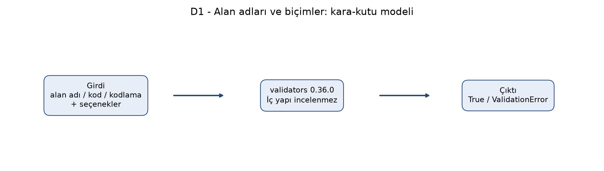
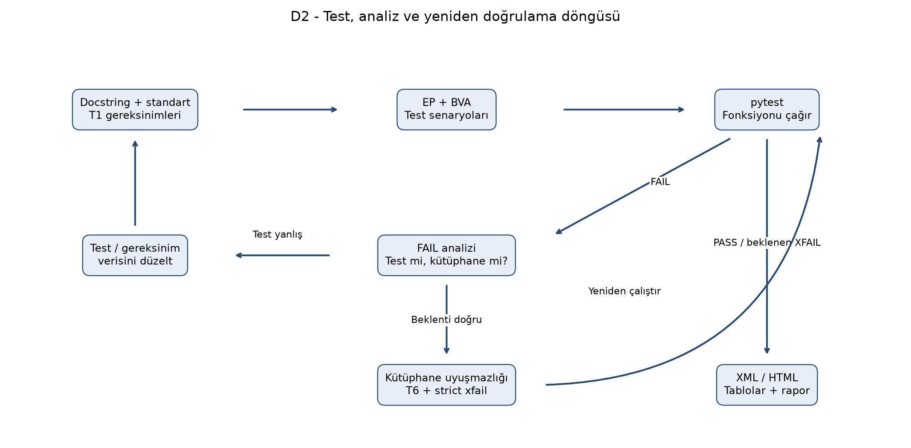
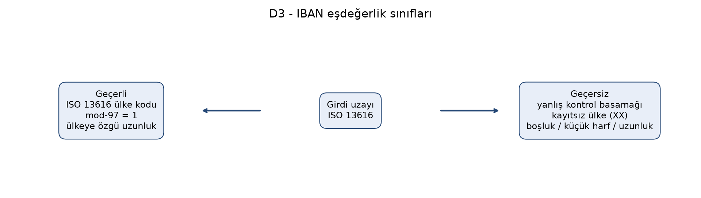
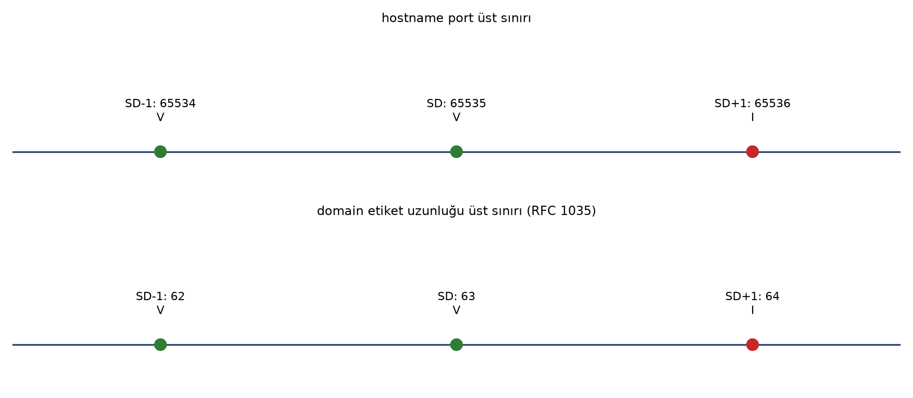
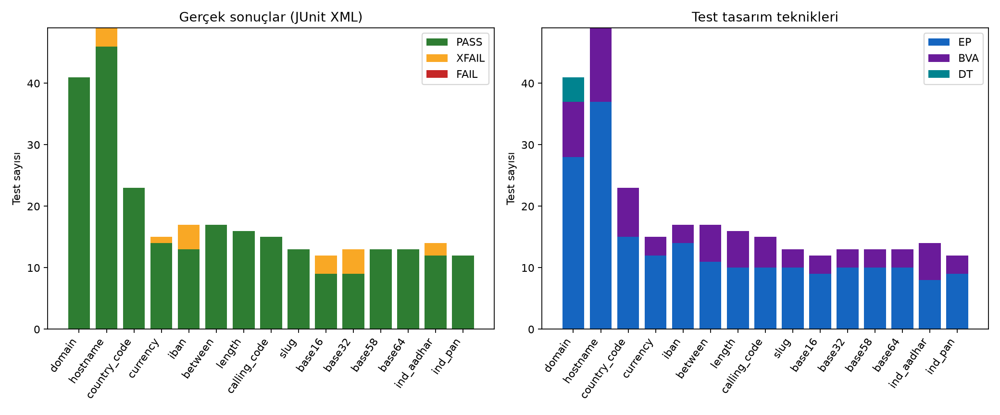

# Kara-Kutu Birim Testi - Alan Adları ve Biçimler

Sorumlu: **AFAHMAD1** (alan 2). Dal: `AFAHMAD1` (PR #2 ile birleşti). Testler, T1 ve T6 bulguları
AFAHMAD1'e aittir. Bu rapor metni ve D1-D5 görselleri, ekip rapor biçimine uydurmak için
**kusayvarde** tarafından mevcut testlerden ve tablolardan derlenmiştir. Doğrulama tarihi: **27 Kasım 2026**.
Sonuç tabloları pytest JUnit XML çıktısından yenilenir.

## 1. Kapsam

Bu çalışmada `domain`, `hostname`, `country_code`, `currency`, `iban`, `between`, `length`,
`calling_code`, `slug`, `base16`, `base32`, `base58`, `base64`, `ind_aadhar` ve `ind_pan`
incelenmiştir. `domain` ve `hostname` çok zor (2 × 5), `country_code`, `currency`, `iban` zor (3 × 3),
`between`, `length`, `calling_code` orta (3 × 2), kalan yedi işlev kolay (7 × 1) olup toplam 32 puandır.

Ortam: Python **3.14.0**, `validators[crypto-eth-addresses]==0.36.0`, pytest **9.2.0**.
Bağımlılıklar mevcut `uv.lock` ile kurulmuştur. Testler biçim, seçenek ve kontrol basamağı
doğrulamasını sınar; bir alan adının DNS'te var olduğunu, bir IBAN'ın açık bir hesaba ait
olduğunu veya bir Aadhaar/PAN numarasının gerçek kişiye atandığını kanıtlamaz.

## 2. Yöntem

**Beklentilerin tasarımında validators kaynak kodu kullanılmamıştır.** Test dosyalarındaki
açıklamalara göre kurallar `inspect.signature()`, `.__doc__` ve aşağıdaki standartlardan
türetilmiştir. Başarısız testler fonksiyon çağrıları ve bağımsız kontrol hesaplarıyla
incelenmiştir. Kök neden yorumları iç uygulama hakkında kanıt değildir.

- **EP:** Geçerli/geçersiz biçimler ve seçenekler ayrı sınıflardır; geçersiz sınıflar birleştirilmez.
- **BVA:** Etiket ve toplam uzunluk, port, ülke kodu uzunluğu, numeric ülke kodu aralığı,
  çağrı kodu rakam sayısı, base32/base64 blok uzunluğu, Aadhaar ilk basamağı ve `between`/`length`
  aralıkları için SD-1/SD/SD+1 üçlüleri kullanılır.
- **Karar tablosu (DT, bonus):** `domain` için `rfc_1034` seçeneği × girdide sondaki nokta
  koşullarının dört birleşimi (R1-R4) ayrı testtir.
- **Bağımsız veri:** IBAN mod-97 ve Aadhaar Verhoeff verileri `uretici/domains_formats.py` ile kütüphaneden
  bağımsız üretilir. Base32/Base64 geçerli örnekleri RFC 4648 §10 test vektörleridir.
- **Örnekler:** Docstring örnekleri ayrı testtir (`Doküman örneği`).





### Kaynaklar ve gereksinim önceliği

İlk sözleşme kurulu **0.36.0** sürümünün docstring'idir. Standarttan eklenen ve docstring'de
açıklanmayan beklentiler T1'de `GEREKSİNİM BELİRSİZLİĞİ` olarak işaretlenmiştir.

- Alan adı ve ana makine: [RFC 1034](https://www.rfc-editor.org/rfc/rfc1034),
  [RFC 1035 §2.3.4](https://www.rfc-editor.org/rfc/rfc1035) (etiket 63, ad 253),
  [RFC 1123](https://www.rfc-editor.org/rfc/rfc1123) (rakamla başlayan etiket),
  [RFC 3696 §2](https://www.rfc-editor.org/rfc/rfc3696) (sayısal TLD yok),
  [RFC 2782](https://www.rfc-editor.org/rfc/rfc2782) (SRV alt çizgisi),
  [RFC 3986 §3.2.2](https://www.rfc-editor.org/rfc/rfc3986) ve [RFC 4291](https://www.rfc-editor.org/rfc/rfc4291) (IPv6 literal),
  [RFC 6335](https://www.rfc-editor.org/rfc/rfc6335) (port 0 ayrılmış, üst sınır 65535).
- Kodlar: ISO 3166-1 (alpha-2, alpha-3, numeric), ISO 4217 (para birimi),
  ITU-T E.164 (ülke çağrı kodu 1-3 basamak), ISO 13616 (IBAN, mod-97-10, ülkeye özgü uzunluk).
- Kodlamalar: [RFC 4648](https://www.rfc-editor.org/rfc/rfc4648) §4 (base64), §6 (base32), §8 (base16);
  Bitcoin Base58 alfabesi (0, O, I, l yok).
- Hindistan: UIDAI Aadhaar (12 basamak, ilk basamak 2-9, Verhoeff kontrolü);
  Gelir Vergisi İdaresi PAN (5 harf + 4 rakam + 1 harf).
- `between` / `length`: yalnızca docstring (kapalı aralık; verilmeyen sınır denetlenmez).

## 3. Gereksinimler (T1)

Asıl dosya: `docs/tablolar/domains_formats/T1_gereksinimler.csv` (UTF-8 BOM, `;`). Her satır tek kuraldır.
Beklenen çıktı sütunu o satırdaki örnek girdiye aittir. Son sütun aynı kuralın hem geçerli hem
geçersiz örneklerini kapsayabilir. Kısaltmalar işlev önekiyle açılır; örneğin `REQ-IBAN`
satırındaki `EP-01`, `TC-IBAN-EP-01` anlamındadır.

<!-- OTOMATIK:T1 -->
| ID | Fonksiyon | Gereksinim | Örnek girdi | Beklenen çıktı | Kaynak | Sınayan testler |
| --- | --- | --- | --- | --- | --- | --- |
| REQ-DOMAIN-01 | domain | Alan adı noktayla ayrılmış en az iki etiketten oluşur (TLD zorunlu) | 'localhost' | ValidationError | Standart (RFC 1034/1035), GEREKSİNİM BELİRSİZLİĞİ | EP-01, EP-02, EP-12, EP-26 |
| REQ-DOMAIN-02 | domain | Etiket yalnızca harf, rakam ve tire içerir; tire ile başlayıp bitmez; rakamla başlayabilir; harf büyüklüğü fark etmez | '-example.com' | ValidationError | Standart (RFC 1034, RFC 1123) | EP-03, EP-04, EP-05, EP-06, EP-13, EP-14, EP-16, EP-24 |
| REQ-DOMAIN-03 | domain | Boş etiket (baştaki/çift nokta) ve boş dize geçersizdir; en kısa etiket 1 karakterdir | 'example..com' | ValidationError | Standart (RFC 1035) | EP-11, EP-18, EP-19, BVA-04..06 |
| REQ-DOMAIN-04 | domain | Etiket en çok 63, toplam ad en çok 253 karakterdir | 'a'×64 + '.com' | ValidationError | Standart (RFC 1035) | BVA-01..03, BVA-07..09 |
| REQ-DOMAIN-05 | domain | TLD tamamen sayısal olamaz | 'example.123' | ValidationError | Standart (RFC 3696 §2) | EP-23 |
| REQ-DOMAIN-06 | domain | Şema, port ve yol içermez | 'example.com/' | ValidationError | Doküman örneği | EP-20, EP-21, EP-27 |
| REQ-DOMAIN-07 | domain | IDN desteklenir (punycode ve Unicode) | 'xn----gtbspbbmkef.xn--p1ai' | True | Doküman örneği | EP-10, EP-28 |
| REQ-DOMAIN-08 | domain | consider_tld=True iken yalnızca IANA TLD'leri kabul edilir | 'example.invalidtld' (consider_tld=True) | ValidationError | Doküman (consider_tld parametresi) | EP-07, EP-22 |
| REQ-DOMAIN-09 | domain | rfc_1034=True iken sondaki nokta kabul edilir, False iken reddedilir | 'example.com.' | True (rfc_1034=True) | Doküman (rfc_1034 parametresi) | EP-08, EP-17, DT-01..04 |
| REQ-DOMAIN-10 | domain | rfc_2782=True iken alt çizgi (SRV adı) kabul edilir, False iken reddedilir | '_sip._tcp.example.com' | True (rfc_2782=True) | Doküman (rfc_2782 parametresi) | EP-09, EP-15, EP-25 |
| REQ-HOSTNAME-01 | hostname | Ad etiketleri harf, rakam ve tire içerir; tire ile başlamaz, boşluk içermez; tek etiketli ad geçerlidir | 'this-pc' | True | Doküman örneği + Standart (RFC 1123) | EP-01, EP-14, EP-15, EP-29, EP-31 |
| REQ-HOSTNAME-02 | hostname | Etiket en çok 63, toplam ad en çok 253 karakterdir | 'a'×64 | ValidationError | Standart (RFC 1035) | BVA-07..12 |
| REQ-HOSTNAME-03 | hostname | İsteğe bağlı port sayısaldır ve 1–65535 aralığındadır (0 ayrılmıştır) | 'example.com:65536' | ValidationError | Doküman örneği + Standart (RFC 6335), GEREKSİNİM BELİRSİZLİĞİ | EP-02, EP-11, EP-12, EP-13, EP-28, EP-30, EP-32, EP-34, EP-36, BVA-01..06 |
| REQ-HOSTNAME-04 | hostname | Geçerli IPv4 adresi kabul edilir; geçersiz IPv4 reddedilir | '999.1.1.1' | ValidationError | Doküman örneği + Standart (RFC 791) | EP-18, EP-32, EP-33 |
| REQ-HOSTNAME-05 | hostname | IPv6 adresi köşeli parantezli (portlu/portsuz) veya köşelisiz kabul edilir | '[2001:db8::1]' | True | Doküman örneği + Standart (RFC 3986 §3.2.2, RFC 4291) | EP-03, EP-04, EP-19, EP-34, EP-35, EP-37 |
| REQ-HOSTNAME-06 | hostname | Boş dize, şema ve yol içeren girdi geçersizdir | 'http://example.com' | ValidationError | Standart (RFC 3986) | EP-10, EP-16, EP-17 |
| REQ-HOSTNAME-07 | hostname | may_have_port=False iken port içeren girdi reddedilir | 'example.com:80' (may_have_port=False) | ValidationError | Doküman (may_have_port parametresi) | EP-20 |
| REQ-HOSTNAME-08 | hostname | skip_ipv4_addr / skip_ipv6_addr=True iken ilgili adres türü reddedilir | '[::1]:22' (skip_ipv6_addr=True) | ValidationError | Doküman (skip_ipv4_addr, skip_ipv6_addr) | EP-21, EP-22 |
| REQ-HOSTNAME-09 | hostname | maybe_simple=False iken tek etiketli ad reddedilir | 'this-pc' (maybe_simple=False) | ValidationError | Doküman (maybe_simple parametresi) | EP-23 |
| REQ-HOSTNAME-10 | hostname | private=True yalnız özel, private=False yalnız genel IP kabul eder | '8.8.8.8' (private=True) | ValidationError | Doküman (private parametresi) | EP-06, EP-07, EP-24, EP-25 |
| REQ-HOSTNAME-11 | hostname | consider_tld=True iken yalnızca IANA TLD'leri kabul edilir | 'example.invalidtld' (consider_tld=True) | ValidationError | Doküman (consider_tld parametresi) | EP-05, EP-26 |
| REQ-HOSTNAME-12 | hostname | rfc_1034=True sondaki noktayı, rfc_2782=True alt çizgili SRV adını kabul eder | 'example.com.' (rfc_1034=True) | True | Doküman (rfc_1034, rfc_2782 parametreleri) | EP-08, EP-09, EP-27 |
| REQ-COUNTRY_CODE-01 | country_code | iso_format=auto iken alpha-2, alpha-3 ve numeric ISO 3166-1 kodları tanınır | 'USA' | True | Doküman örneği + Standart (ISO 3166-1) | EP-01, EP-12 |
| REQ-COUNTRY_CODE-02 | country_code | iso_format alpha2/alpha3/numeric seçilirse yalnızca o biçim kabul edilir | 'GB' (iso_format=alpha3) | ValidationError | Doküman (iso_format parametresi) | EP-08, EP-11, EP-13, EP-14, EP-15 |
| REQ-COUNTRY_CODE-03 | country_code | Atanmamış, yanlış uzunlukta veya hatalı karakterli kod reddedilir | 'ZZ' | ValidationError | Standart (ISO 3166-1) | EP-04, EP-06, EP-07, EP-09, EP-10, BVA-01..04 |
| REQ-COUNTRY_CODE-04 | country_code | Varsayılan olarak büyük/küçük harf duyarlıdır; ignore_case=True ile duyarsız | 'us' | ValidationError | Doküman (ignore_case parametresi) | EP-02, EP-05 |
| REQ-COUNTRY_CODE-05 | country_code | Numeric kod 3 basamaktır (baştaki sıfır korunur) ve 004–894 aralığındadır | '895' (numeric) | ValidationError | Standart (ISO 3166-1 numeric) | EP-03, BVA-05..08 |
| REQ-CURRENCY-01 | currency | Para birimi kodu 3 büyük harfli ISO 4217 kodudur (XXX, XTS gibi özel kodlar dahil) | 'USD' | True | Doküman örneği + Standart (ISO 4217) | EP-01, EP-04, EP-11, EP-12, BVA-01..03 |
| REQ-CURRENCY-02 | currency | Atanmamış kod, rakamlı ve boş girdi reddedilir | 'ZWX' | ValidationError | Doküman örneği | EP-05, EP-07, EP-09 |
| REQ-CURRENCY-03 | currency | Varsayılan olarak büyük/küçük harf duyarlıdır; ignore_case=True ile duyarsız | 'usd' | ValidationError | Doküman (ignore_case parametresi) | EP-02, EP-06 |
| REQ-CURRENCY-04 | currency | Semboller yalnızca skip_symbols=False iken doğrulanır | '$' (skip_symbols=False) | True | Doküman (skip_symbols parametresi) | EP-03, EP-08, EP-10 |
| REQ-CALLING_CODE-01 | calling_code | Çağrı kodu '+' ile başlar ve 1–3 rakamdan oluşur | '+1234' | ValidationError | Doküman örneği + Standart (ITU-T E.164) | EP-01, EP-02, EP-03, EP-09, BVA-01..05 |
| REQ-CALLING_CODE-02 | calling_code | Atanmamış ülke kodu reddedilir | '+999' | ValidationError | Standart (ITU-T E.164) | EP-05 |
| REQ-CALLING_CODE-03 | calling_code | Boş dize, harf, boşluk ve çift '+' içeren girdi reddedilir | '-31' | ValidationError | Doküman örneği | EP-04, EP-06, EP-07, EP-08, EP-10 |
| REQ-IBAN-01 | iban | IBAN kontrol basamakları mod-97-10 kuralını sağlar | 'DE89370400440532013001' | ValidationError | Doküman örneği + Standart (ISO 13616) | EP-01, EP-02, EP-03, EP-04, EP-05, EP-07, EP-13 |
| REQ-IBAN-02 | iban | Ülke kodu ISO 13616 kaydında bulunan 2 büyük harftir | 'XX…' (mod-97 doğru) | ValidationError | Standart (ISO 13616) | EP-08, EP-11 |
| REQ-IBAN-03 | iban | IBAN uzunluğu ülkeye özgüdür (ör. Almanya 22) | Almanya 21 / 23 karakter | ValidationError | Standart (ISO 13616) | BVA-01..03 |
| REQ-IBAN-04 | iban | Elektronik biçim: büyük harf, boşluksuz, özel karaktersiz | 'DE89 3704 …' | ValidationError | Standart (ISO 13616), GEREKSİNİM BELİRSİZLİĞİ | EP-09, EP-10, EP-12 |
| REQ-IBAN-05 | iban | Boş veya anlamsız girdi geçersizdir | '123456' | ValidationError | Doküman örneği | EP-06, EP-14 |
| REQ-BETWEEN-01 | between | Değer [min_val, max_val] kapalı aralığındaysa True (sayı, metin, tarih) | 5 (min_val=1, max_val=10) | True | Doküman örneği | EP-01, EP-03, EP-04, EP-08, EP-09, EP-11 |
| REQ-BETWEEN-02 | between | Sınır değerlerinin kendisi aralığa dahildir | 10 (min_val=1, max_val=10) | True | Doküman | BVA-01..06 |
| REQ-BETWEEN-03 | between | Değer aralığın dışındaysa ValidationError | 11 (min_val=1, max_val=10) | ValidationError | Doküman örneği | EP-05, EP-06, EP-07, EP-10 |
| REQ-BETWEEN-04 | between | Verilmeyen sınır denetlenmez; ikisi de yoksa sonuç her zaman True | 5 (sınır yok) | True | Doküman (Note) | EP-02 |
| REQ-LENGTH-01 | length | Dize uzunluğu [min_val, max_val] aralığındaysa True (Unicode karakter sayısıyla) | 'abcd' (min_val=2, max_val=6) | True | Doküman örneği | EP-01, EP-04, EP-08, EP-09, BVA-01..06 |
| REQ-LENGTH-02 | length | Uzunluk aralığın dışındaysa ValidationError | 'a' (min_val=2) | ValidationError | Doküman örneği | EP-05, EP-06, EP-07, EP-10 |
| REQ-LENGTH-03 | length | Verilmeyen sınır denetlenmez; boş dize min_val=0 ile geçerlidir | '' (min_val=0) | True | Doküman | EP-02, EP-03 |
| REQ-SLUG-01 | slug | Slug yalnızca küçük harf, rakam ve tire içerir | 'my-slug-2134' | True | Doküman örneği | EP-01, EP-02, EP-09 |
| REQ-SLUG-02 | slug | Büyük harf, alt çizgi, boşluk ve nokta geçersizdir | 'my.slug' | ValidationError | Doküman örneği | EP-04, EP-07, EP-08, EP-10 |
| REQ-SLUG-03 | slug | Slug tire ile başlayıp bitemez | '-abc' | ValidationError | Doküman | EP-05, EP-06 |
| REQ-SLUG-04 | slug | Boş dize geçersizdir; en kısa geçerli slug 1 karakterdir | '' | ValidationError | Ekip kuralı (doküman belirtmiyor) | EP-03, BVA-01..03 |
| REQ-BASE16-01 | base16 | Yalnızca hex karakterleri (0-9, A-F, a-f) içerir | 'a3f4Z1' | ValidationError | Doküman örneği + Standart (RFC 4648 §8) | EP-01, EP-02, EP-04, EP-05, EP-06, EP-08, EP-09 |
| REQ-BASE16-02 | base16 | Uzunluk çifttir (bayt başına 2 karakter) | 'abc' | ValidationError | Standart (RFC 4648 §8), GEREKSİNİM BELİRSİZLİĞİ | EP-07, BVA-01..03 |
| REQ-BASE16-03 | base16 | Boş dize geçersizdir | '' | ValidationError | Ekip kuralı (doküman belirtmiyor) | EP-03 |
| REQ-BASE32-01 | base32 | Alfabe büyük harf A-Z ve 2-7'dir | 'MfZW3zLT9Q======' | ValidationError | Doküman örneği + Standart (RFC 4648 §6) | EP-01, EP-02, EP-03, EP-05, EP-06, EP-09, EP-10 |
| REQ-BASE32-02 | base32 | Uzunluk '=' dolgusuyla 8'in katıdır | 'MZXW6' | ValidationError | Standart (RFC 4648 §6), GEREKSİNİM BELİRSİZLİĞİ | EP-07, EP-08, BVA-01..03 |
| REQ-BASE32-03 | base32 | Boş dize geçersizdir | '' | ValidationError | Ekip kuralı (doküman belirtmiyor) | EP-04 |
| REQ-BASE58-01 | base58 | Alfabe 58 karakterdir (0, O, I, l yok) | 'ab0c' | ValidationError | Doküman örneği + Standart (Bitcoin Base58) | EP-01, EP-02, EP-04, EP-05, EP-06, EP-07, EP-09, EP-10 |
| REQ-BASE58-02 | base58 | Boşluk ve boş dize geçersizdir; en kısa geçerli dize 1 karakterdir | '' | ValidationError | Ekip kuralı (doküman belirtmiyor) | EP-03, EP-08, BVA-01..03 |
| REQ-BASE64-01 | base64 | Alfabe A-Z, a-z, 0-9, '+', '/' ve '=' dolgusudur (URL-güvenli '-' '_' değil) | 'Zm-_' | ValidationError | Doküman örneği + Standart (RFC 4648 §4) | EP-01, EP-02, EP-03, EP-05, EP-06, EP-09 |
| REQ-BASE64-02 | base64 | Uzunluk 4'ün katıdır; dolgu yalnızca sonda ve en çok 2 karakterdir | 'cUSECm5YzcXJwP' | ValidationError | Doküman örneği + Standart (RFC 4648 §4) | EP-07, EP-08, EP-10, BVA-01..03 |
| REQ-BASE64-03 | base64 | Boş dize geçersizdir | '' | ValidationError | Ekip kuralı (doküman belirtmiyor) | EP-04 |
| REQ-IND_AADHAR-01 | ind_aadhar | Aadhaar 12 basamaktır ve '4-4-4' boşluklu biçimde yazılır | '3675 9834 6015' | True | Doküman örneği, GEREKSİNİM BELİRSİZLİĞİ (boşluksuz biçim) | EP-01, EP-02, EP-07, BVA-04..06 |
| REQ-IND_AADHAR-02 | ind_aadhar | İlk basamak 2–9'dur (0 ve 1 olamaz) | '0345 6789 0127' | ValidationError | Standart (UIDAI) | EP-04, BVA-01..03 |
| REQ-IND_AADHAR-03 | ind_aadhar | Son basamak Verhoeff kontrol basamağıdır | bozuk kontrol basamaklı numara | ValidationError | Standart (UIDAI, Verhoeff algoritması) | EP-03 |
| REQ-IND_AADHAR-04 | ind_aadhar | Rakam dışı karakter içeren veya boş girdi geçersizdir | '3675 ABVC 2133' | ValidationError | Doküman örneği | EP-05, EP-06, EP-08 |
| REQ-IND_PAN-01 | ind_pan | PAN 5 büyük harf + 4 rakam + 1 büyük harf biçimindedir | 'ABCDE9999K' | True | Doküman örneği + Standart (Gelir Vergisi İdaresi) | EP-01, EP-03, EP-04, EP-05, EP-06, EP-08, EP-09 |
| REQ-IND_PAN-02 | ind_pan | PAN tam 10 karakterdir | 'ABCPE1234FF' | ValidationError | Standart (Gelir Vergisi İdaresi) | BVA-01..03 |
| REQ-IND_PAN-03 | ind_pan | Boş dize ve boşluklu girdi geçersizdir | '' | ValidationError | Ekip kuralı (doküman belirtmiyor) | EP-02, EP-07 |
<!-- /OTOMATIK:T1 -->

## 4. Eşdeğerlik sınıfları (T2)

Tam T2, `reports/tablolar.xlsx` içindeki **T2 Eşdeğerlik Sınıfları** sayfasında işlev adına göre
filtrelenebilir. Sınıflar kod içindeki `tc` işaretlerinden otomatik üretilir.

Aşağıdaki temsilciler de aynı pytest XML verisinden alınır; her işlev için bir geçerli ve bir
geçersiz EP örneği gösterilir.

<!-- OTOMATIK:T2 -->
| Fonksiyon | Sınıf | Temsilci girdi | Beklenen | Test ID |
| --- | --- | --- | --- | --- |
| domain | V1 standart alan adı | 'example.com' | True | TC-DOMAIN-EP-01 |
| domain | I1 boş string | '' | ValidationError | TC-DOMAIN-EP-11 |
| hostname | V1 standart FQDN | 'example.com' | True | TC-HOSTNAME-EP-01 |
| hostname | I1 boş string | '' | ValidationError | TC-HOSTNAME-EP-10 |
| country_code | V1 alpha-2 (auto) | 'US' | True | TC-COUNTRY_CODE-EP-01 |
| country_code | I1 boş string | '' | ValidationError | TC-COUNTRY_CODE-EP-04 |
| currency | V1 ISO 4217 kodu | 'EUR' | True | TC-CURRENCY-EP-01 |
| currency | I1 boş string | '' | ValidationError | TC-CURRENCY-EP-05 |
| iban | V1 Birleşik Krallık (22, harfli BBAN) | 'GB82WEST12345698765432' | True | TC-IBAN-EP-01 |
| iban | I1 boş string | '' | ValidationError | TC-IBAN-EP-06 |
| between | V1 tamsayı aralık içinde | 5 | True | TC-BETWEEN-EP-01 |
| between | I1 min_val altında | 0 | ValidationError | TC-BETWEEN-EP-05 |
| length | V1 uzunluk aralık içinde | 'abcd' | True | TC-LENGTH-EP-01 |
| length | I1 min_val'den kısa | 'a' | ValidationError | TC-LENGTH-EP-05 |
| calling_code | V1 tek basamaklı kod (+1) | '+1' | True | TC-CALLING_CODE-EP-01 |
| calling_code | I1 boş string | '' | ValidationError | TC-CALLING_CODE-EP-04 |
| slug | V1 yalnızca küçük harf | 'abc' | True | TC-SLUG-EP-01 |
| slug | I1 boş string | '' | ValidationError | TC-SLUG-EP-03 |
| base16 | V1 büyük harf hex (RFC 4648 alfabesi) | 'A3F4B2' | True | TC-BASE16-EP-01 |
| base16 | I1 boş string | '' | ValidationError | TC-BASE16-EP-03 |
| base32 | V1 6 dolgu karakteri ('foobar') | 'MZXW6YTBOI======' | True | TC-BASE32-EP-01 |
| base32 | I1 boş string | '' | ValidationError | TC-BASE32-EP-04 |
| base58 | V1 tek karakter | 'z' | True | TC-BASE58-EP-01 |
| base58 | I1 boş string | '' | ValidationError | TC-BASE58-EP-03 |
| base64 | V1 dolgusuz ('foobar') | 'Zm9vYmFy' | True | TC-BASE64-EP-01 |
| base64 | I1 boş string | '' | ValidationError | TC-BASE64-EP-04 |
| ind_aadhar | V1 12 basamak, boşluksuz, Verhoeff doğru | '234567890124' | True | TC-IND_AADHAR-EP-01 |
| ind_aadhar | I1 yanlış Verhoeff kontrol basamağı | '2345 6789 0125' | ValidationError | TC-IND_AADHAR-EP-03 |
| ind_pan | V1 5 harf + 4 rakam + 1 harf | 'ABCPE1234F' | True | TC-IND_PAN-EP-01 |
| ind_pan | I1 boş string | '' | ValidationError | TC-IND_PAN-EP-02 |
<!-- /OTOMATIK:T2 -->

| İşlev | Geçerli sınıf | Geçersiz sınıf |
| --- | --- | --- |
| domain | LDH etiketleri + TLD, IDN, seçenekli nokta/SRV | Boş etiket, tire kenarı, sayısal TLD, şema/port |
| hostname | Ad, IPv4/IPv6, isteğe bağlı port, seçenekler | Port dışı, şema/yol, yasaklanan adres türü |
| country_code | alpha-2/alpha-3/numeric ISO 3166-1 | Atanmamış kod, yanlış biçim/uzunluk, küçük harf |
| currency | ISO 4217 kodu, seçenekle sembol | Atanmamış kod, rakam, boş, küçük harf |
| iban | ISO 13616 ülke + mod-97 | Yanlış kontrol, kayıtsız ülke, boşluk, uzunluk |
| between / length | Kapalı aralık içi, verilmeyen sınır | Aralık dışı |
| calling_code | '+' ve 1-3 rakam, atanmış kod | Atanmamış kod, harf, boşluk, çift '+' |
| slug | Küçük harf, rakam, tire | Büyük harf, alt çizgi, boşluk, kenarda tire |
| base16/32/58/64 | Standart alfabe (ve dolgu) | Alfabe dışı karakter, boş, yanlış uzunluk |
| ind_aadhar | 4-4-4 biçimi, ilk basamak 2-9, Verhoeff | İlk basamak 0/1, harf, yanlış kontrol |
| ind_pan | AAAAA9999A | Uzunluk, küçük harf, boşluk, konum hatası |



`between` ve `length` için `min_val > max_val`, negatif uzunluk ve tür uyuşmazlığı durumlarında
docstring `ValueError`/`TypeError` fırlatıldığını belirtir. Ortak `dogrula` sözleşmesi
`ValidationError` dönüşü beklediği için bu durumlar kapsam dışı bırakılmış ve GÖZLEM-21 olarak
kaydedilmiştir.

## 5. Sınır değer analizi (T3)

DNS'te etiket (63) ve toplam ad (253) iki ayrı sınırdır; hostname'de ayrıca port üst (65535) ve
port alt sınırı vardır. `country_code` için alfabetik kod uzunluğu (2/3) ve numeric kodun
004-894 aralığı ayrı gruplardır. `between`/`length` iki taraflı aralık olduğundan altı test içerir.
IBAN'da ülkeye özgü uzunluk Almanya (22) üzerinden sınanır; 21 ve 23 karakterli verilerde mod-97
kontrolü yeniden hesaplanmıştır, böylece kontrol hatası uzunluk sınırını maskelemez.
Base58'de sayısal uzunluk sınırı tanımlı olmadığından yalnızca en küçük uzunluk (1) sınanır.



<!-- OTOMATIK:T3 -->
| Fonksiyon | Sınır | SD-1 | SD | SD+1 | Beklenen | Test ID |
| --- | --- | --- | --- | --- | --- | --- |
| between | Alt sınır | 0  [min_val=1, max_val=10] | 1  [min_val=1, max_val=10] | 2  [min_val=1, max_val=10] | I / V / V | TC-BETWEEN-BVA-01, TC-BETWEEN-BVA-02, TC-BETWEEN-BVA-03 |
| between | Üst sınır | 9  [min_val=1, max_val=10] | 10  [min_val=1, max_val=10] | 11  [min_val=1, max_val=10] | V / V / I | TC-BETWEEN-BVA-04, TC-BETWEEN-BVA-05, TC-BETWEEN-BVA-06 |
| length | Alt sınır | 'ab'  [min_val=3, max_val=6] | 'abc'  [min_val=3, max_val=6] | 'abcd'  [min_val=3, max_val=6] | I / V / V | TC-LENGTH-BVA-01, TC-LENGTH-BVA-02, TC-LENGTH-BVA-03 |
| length | Üst sınır | 'abcde'  [min_val=3, max_val=6] | 'abcdef'  [min_val=3, max_val=6] | 'abcdefg'  [min_val=3, max_val=6] | V / V / I | TC-LENGTH-BVA-04, TC-LENGTH-BVA-05, TC-LENGTH-BVA-06 |
| domain | Etiket uzunluğu üst | 'aaaaaaaaaaaa…' (66 karakter)  → sınır değeri (62) | 'aaaaaaaaaaaa…' (67 karakter)  → sınır değeri (63) | 'aaaaaaaaaaaa…' (68 karakter)  → sınır değeri (64) | V / V / I | TC-DOMAIN-BVA-01, TC-DOMAIN-BVA-02, TC-DOMAIN-BVA-03 |
| domain | Etiket uzunluğu alt | '.com' | 'a.com' | 'ab.com' | I / V / V | TC-DOMAIN-BVA-04, TC-DOMAIN-BVA-05, TC-DOMAIN-BVA-06 |
| domain | Toplam uzunluk üst | 'aaaaaaaaaaaa…' (252 karakter)  → sınır değeri (252) | 'aaaaaaaaaaaa…' (253 karakter)  → sınır değeri (253) | 'aaaaaaaaaaaa…' (254 karakter)  → sınır değeri (254) | V / V / I | TC-DOMAIN-BVA-07, TC-DOMAIN-BVA-08, TC-DOMAIN-BVA-09 |
| hostname | Port üst | 'example.com:65534' | 'example.com:65535' | 'example.com:65536' | V / V / I | TC-HOSTNAME-BVA-01, TC-HOSTNAME-BVA-02, TC-HOSTNAME-BVA-03 |
| hostname | Port alt | 'example.com:0' | 'example.com:1' | 'example.com:2' | I / V / V | TC-HOSTNAME-BVA-04, TC-HOSTNAME-BVA-05, TC-HOSTNAME-BVA-06 |
| hostname | Etiket uzunluğu üst | 'aaaaaaaaaaaa…' (62 karakter)  → sınır değeri (62) | 'aaaaaaaaaaaa…' (63 karakter)  → sınır değeri (63) | 'aaaaaaaaaaaa…' (64 karakter)  → sınır değeri (64) | V / V / I | TC-HOSTNAME-BVA-07, TC-HOSTNAME-BVA-08, TC-HOSTNAME-BVA-09 |
| hostname | Toplam uzunluk üst | 'aaaaaaaaaaaa…' (252 karakter)  → sınır değeri (252) | 'aaaaaaaaaaaa…' (253 karakter)  → sınır değeri (253) | 'aaaaaaaaaaaa…' (254 karakter)  → sınır değeri (254) | V / V / I | TC-HOSTNAME-BVA-10, TC-HOSTNAME-BVA-11, TC-HOSTNAME-BVA-12 |
| ind_aadhar | İlk basamak alt | '1234 5678 9010' | '2234 5678 9018' | '3234 5678 9012' | I / V / V | TC-IND_AADHAR-BVA-01, TC-IND_AADHAR-BVA-02, TC-IND_AADHAR-BVA-03 |
| ind_aadhar | Basamak sayısı | '2345 6789 019' | '2345 6789 0124' | '2345 6789 0123 2' | I / V / I | TC-IND_AADHAR-BVA-04, TC-IND_AADHAR-BVA-05, TC-IND_AADHAR-BVA-06 |
| ind_pan | Uzunluk | 'ABCPE1234' | 'ABCPE1234F' | 'ABCPE1234FF' | I / V / I | TC-IND_PAN-BVA-01, TC-IND_PAN-BVA-02, TC-IND_PAN-BVA-03 |
| slug | Uzunluk alt | '' | 'a' | 'ab' | I / V / V | TC-SLUG-BVA-01, TC-SLUG-BVA-02, TC-SLUG-BVA-03 |
| base16 | Uzunluk alt | 'a' | 'ab' | 'abc' | I / V / I | TC-BASE16-BVA-01, TC-BASE16-BVA-02, TC-BASE16-BVA-03 |
| base32 | Blok uzunluğu | 'MZXW6YT' | 'MZXW6YTB' | 'MZXW6YTBO' | I / V / I | TC-BASE32-BVA-01, TC-BASE32-BVA-02, TC-BASE32-BVA-03 |
| base58 | Uzunluk alt | '' | 'z' | 'zz' | I / V / V | TC-BASE58-BVA-01, TC-BASE58-BVA-02, TC-BASE58-BVA-03 |
| base64 | Blok uzunluğu | 'Zm9' | 'Zm9v' | 'Zm9vY' | I / V / I | TC-BASE64-BVA-01, TC-BASE64-BVA-02, TC-BASE64-BVA-03 |
| country_code | Alfabetik kod alt | 'U' | 'US' | 'USA' | I / V / V | TC-COUNTRY_CODE-BVA-01, TC-COUNTRY_CODE-BVA-02, TC-COUNTRY_CODE-BVA-03 |
| country_code | Alfabetik kod üst | — | — | 'USAA' | — / — / I | TC-COUNTRY_CODE-BVA-04 |
| country_code | Numeric alt | '003'  [iso_format=numeric] | '004'  [iso_format=numeric] | — | I / V / — | TC-COUNTRY_CODE-BVA-05, TC-COUNTRY_CODE-BVA-06 |
| country_code | Numeric üst | — | '894'  [iso_format=numeric] | '895'  [iso_format=numeric] | — / V / I | TC-COUNTRY_CODE-BVA-07, TC-COUNTRY_CODE-BVA-08 |
| currency | Kod uzunluğu | 'US' | 'USD' | 'USDD' | I / V / I | TC-CURRENCY-BVA-01, TC-CURRENCY-BVA-02, TC-CURRENCY-BVA-03 |
| calling_code | Rakam sayısı alt | '+' | '+1' | '+44' | I / V / V | TC-CALLING_CODE-BVA-01, TC-CALLING_CODE-BVA-02, TC-CALLING_CODE-BVA-03 |
| calling_code | Rakam sayısı üst | — | '+971' | '+1234' | — / V / I | TC-CALLING_CODE-BVA-04, TC-CALLING_CODE-BVA-05 |
| iban | Almanya uzunluğu | 'DE5137040044053201300' | 'DE89370400440532013000' | 'DE813704004405320130000' | I / V / I | TC-IBAN-BVA-01, TC-IBAN-BVA-02, TC-IBAN-BVA-03 |
<!-- /OTOMATIK:T3 -->

### Karar tablosu (DT)

`domain(value, rfc_1034=...)`: koşullar *rfc_1034 açık mı?* ve *girdide sondaki nokta var mı?*;
eylem *kabul / red*. Dört kuralın tamamı test edilmiştir.

<!-- OTOMATIK:DT -->
| Test ID | Kural | Parametreler | Girdi | Beklenen | Gerçekleşen | Durum |
| --- | --- | --- | --- | --- | --- | --- |
| TC-DOMAIN-DT-01 | R1 rfc_1034=F nokta yok | rfc_1034=False | 'example.com' | True | True | PASS |
| TC-DOMAIN-DT-02 | R2 rfc_1034=F nokta var | rfc_1034=False | 'example.com.' | ValidationError | ValidationError | PASS |
| TC-DOMAIN-DT-03 | R3 rfc_1034=T nokta yok | rfc_1034=True | 'example.com' | True | True | PASS |
| TC-DOMAIN-DT-04 | R4 rfc_1034=T nokta var | rfc_1034=True | 'example.com.' | True | True | PASS |
<!-- /OTOMATIK:DT -->

## 6. Test senaryoları (T4)

Tam liste `reports/tablolar.xlsx` içindeki **T4a Test Senaryoları** ve **T4b Test Sonuçları**
sayfalarındadır; işlev sütunundan bu bölümün on beş işlevi seçilir. T4a'da gerçek sonuç/durum boş
bırakılır; T4b yalnızca pytest XML çıktısından doldurulur. Bu çıktılar Git'e eklenmez. Koddaki her
senaryonun kimliği T1 ile eşleşir.

Her işlevden bir BVA kaydının gerçekleşen sonucu aşağıda pytest XML'den gösterilir:

<!-- OTOMATIK:T4 -->
| Test ID | Girdi | Parametreler | Beklenen | Gerçekleşen | Durum |
| --- | --- | --- | --- | --- | --- |
| TC-DOMAIN-BVA-01 | 'aaaaaaaaaaaaaaaaaaaaaaaaaaaaaaaaaaaaaaaaaaaaaaaaaaaaaaaaaaa… (66 karakter) | — | True | True | PASS |
| TC-HOSTNAME-BVA-01 | 'example.com:65534' | — | True | True | PASS |
| TC-COUNTRY_CODE-BVA-01 | 'U' | — | ValidationError | ValidationError | PASS |
| TC-CURRENCY-BVA-01 | 'US' | — | ValidationError | ValidationError | PASS |
| TC-IBAN-BVA-01 | 'DE5137040044053201300' | — | ValidationError | True | XFAIL |
| TC-BETWEEN-BVA-01 | 0 | min_val=1, max_val=10 | ValidationError | ValidationError | PASS |
| TC-LENGTH-BVA-01 | 'ab' | min_val=3, max_val=6 | ValidationError | ValidationError | PASS |
| TC-CALLING_CODE-BVA-01 | '+' | — | ValidationError | ValidationError | PASS |
| TC-SLUG-BVA-01 | '' | — | ValidationError | ValidationError | PASS |
| TC-BASE16-BVA-01 | 'a' | — | ValidationError | True | XFAIL |
| TC-BASE32-BVA-01 | 'MZXW6YT' | — | ValidationError | True | XFAIL |
| TC-BASE58-BVA-01 | '' | — | ValidationError | ValidationError | PASS |
| TC-BASE64-BVA-01 | 'Zm9' | — | ValidationError | ValidationError | PASS |
| TC-IND_AADHAR-BVA-01 | '1234 5678 9010' | — | ValidationError | ValidationError | PASS |
| TC-IND_PAN-BVA-01 | 'ABCPE1234' | — | ValidationError | ValidationError | PASS |
<!-- /OTOMATIK:T4 -->

Örnek: `TC-IBAN-BVA-03` mod-97 kontrolü doğru, 23 karakterli bir Almanya IBAN'ını reddetmeyi
bekler; tek bozulan kural ülkeye özgü uzunluktur. `TC-HOSTNAME-BVA-08` 63 karakterlik tek etiketli
ana makine adını, RFC 1035 etiket sınırında sınar.

## 7. Otomasyon

`test_domain_hostname.py`, `test_kodlar.py`, `test_aralik.py`, `test_kodlamalar.py` ve
`test_hindistan.py` dosyaları ortak `tc` ve `dogrula` yapısını kullanır:

```python
@pytest.mark.parametrize("girdi, parametreler, beklenen", DOMAIN_EP + DOMAIN_BVA + DOMAIN_DT)
def test_domain(dogrula, girdi, parametreler, beklenen):
    dogrula("domain", girdi, parametreler, beklenen)
```

`dogrula` geçerli sonuçta `sonuc is True`, geçersiz sonuçta hem falsy değer hem `ValidationError`
tipini denetler. `pytest.raises` kullanılmaz. Bulgular `bug="BUG-2x: ..."` biçiminde **strict xfail**
olarak korunur; beklenmedik bir düzelme XPASS nedeniyle test çalışmasını başarısız yapar.

PowerShell ile depo kökünden yeniden üretim:

```powershell
$env:PYTHONIOENCODING = 'utf-8'
uv sync --locked
uv run pytest
uv run python scripts/sonuc_tablosu.py
uv run python -m uretici.domains_formats
uv run python scripts/rapor_uret.py domains_formats
```

Son komut bu bölümün raporundaki otomatik blokları, T6'nın Girdi/Beklenen/Gerçekleşen sütunlarını
(pytest sonucundan; elle doldurulmaz) ve kendi D1-D5 görsellerini yeniler.

## 8. Sonuçlar (T5)

Aşağıdaki sayılar mevcut JUnit XML dosyasından hesaplanmıştır. XFAIL, işlevin doğru çalıştığı
anlamına gelmez; belgelenmiş bir uyuşmazlığın yeniden gözlendiğini gösterir.

<!-- OTOMATIK:T5 -->
| Fonksiyon | Toplam | EP | BVA | DT | PASS | FAIL | XFAIL |
| --- | --- | --- | --- | --- | --- | --- | --- |
| domain | 41 | 28 | 9 | 4 | 41 | 0 | 0 |
| hostname | 49 | 37 | 12 | 0 | 46 | 0 | 3 |
| country_code | 23 | 15 | 8 | 0 | 23 | 0 | 0 |
| currency | 15 | 12 | 3 | 0 | 14 | 0 | 1 |
| iban | 17 | 14 | 3 | 0 | 13 | 0 | 4 |
| between | 17 | 11 | 6 | 0 | 17 | 0 | 0 |
| length | 16 | 10 | 6 | 0 | 16 | 0 | 0 |
| calling_code | 15 | 10 | 5 | 0 | 15 | 0 | 0 |
| slug | 13 | 10 | 3 | 0 | 13 | 0 | 0 |
| base16 | 12 | 9 | 3 | 0 | 9 | 0 | 3 |
| base32 | 13 | 10 | 3 | 0 | 9 | 0 | 4 |
| base58 | 13 | 10 | 3 | 0 | 13 | 0 | 0 |
| base64 | 13 | 10 | 3 | 0 | 13 | 0 | 0 |
| ind_aadhar | 14 | 8 | 6 | 0 | 12 | 0 | 2 |
| ind_pan | 12 | 9 | 3 | 0 | 12 | 0 | 0 |
| TOPLAM | 283 | 203 | 76 | 4 | 266 | 0 | 17 |

Alan: 283 test, 266 PASS, 0 FAIL, 17 XFAIL. Tüm depo: 995 test, 940 PASS, 0 FAIL, 55 XFAIL.

T1: 68 gereksinim; T3: 27 sınır grubu. Başarı oranı: %94.0 (XFAIL başarıya eklenmemiştir).
<!-- /OTOMATIK:T5 -->



İncelenebilir yürütme kanıtları: `reports/sonuc.xml` ve `reports/rapor.html`. Sonuçlar
çalıştırma tarihindeki kilitli sürümlere aittir; başka sürümler için genellenemez.

## 9. Bulgular ve analiz (T6)

<!-- OTOMATIK:T6 -->
| Bulgu ID | Test ID | Girdi | Beklenen | Gerçekleşen | Kök neden yorumu | Önem |
| --- | --- | --- | --- | --- | --- | --- |
| BUG-20 | TC-HOSTNAME-BVA-07, TC-HOSTNAME-BVA-08 | 'aaaaaaaaaaaaaaaaaaaaaaaaaaaaaaaaaaaaaaaaaaaaaaaaaaaaaaaaaaa… (62 karakter) \| 'aaaaaaaaaaaaaaaaaaaaaaaaaaaaaaaaaaaaaaaaaaaaaaaaaaaaaaaaaaa… (63 karakter) | True | ValidationError | Tek etiketli hostname yalnızca 61 karaktere kadar kabul ediliyor (1-61 kabul, 62 ve 63 reddediliyor). RFC 1035 etiket sınırı 63'tür. Doküman uzunluk sınırı belirtmiyor; davranış standartla uyumsuz. 'a'×63 + '.com' kabul ediliyor, yani yalnızca tek etiketli yol etkileniyor. | Düşük |
| BUG-21 | TC-HOSTNAME-EP-03 | '[2001:db8::1]' | True | ValidationError | Köşeli parantezli IPv6 port olmadan reddediliyor, port ile ('[::1]:22', dokümanın kendi örneği) kabul ediliyor. Doküman portu isteğe bağlı sayıyor (may_have_port) ve RFC 3986 §3.2.2 köşeli IP-literal'in portsuz yazılmasına izin veriyor. Köşelisiz '::1' kabul ediliyor. | Orta |
| BUG-22 | TC-IBAN-BVA-01, TC-IBAN-BVA-03 | 'DE5137040044053201300' \| 'DE813704004405320130000' | ValidationError | True | IBAN'ın ülkeye özgü uzunluğu denetlenmiyor: mod-97 doğruysa 15-34 arası her uzunluk kabul ediliyor (14 ve 35 reddediliyor). ISO 13616'ya göre Almanya IBAN'ı tam 22 karakterdir. Doküman yalnızca 'geçerli IBAN' diyor (gereksinim belirsizliği). | Orta |
| BUG-23 | TC-IBAN-EP-08 | 'XX831234567890123456' | ValidationError | True | ISO 13616 kaydında olmayan ülke kodu ('XX') mod-97 doğruysa kabul ediliyor; ülke kodu kayıtla karşılaştırılmıyor. | Orta |
| BUG-24 | TC-IBAN-EP-09 | 'de89370400440532013000' | ValidationError | True | Küçük harfli IBAN kabul ediliyor. ISO 13616 elektronik biçimi büyük harf kullanır; ancak doküman bu konuda sessiz olduğu için gereksinim belirsizliği vardır. Boşluklu basılı biçim doğru şekilde reddediliyor (TC-IBAN-EP-10 PASS). | Düşük |
| BUG-25 | TC-CURRENCY-EP-04 | 'XXX' | True | ValidationError | ISO 4217'de tanımlı özel kodlardan XXX, XTS ve XAU reddediliyor; XDR, XOF ve XAF kabul ediliyor. Doküman 'ISO 4217 para birimi kodu' diyor ve istisna belirtmiyor; davranış tutarsız. Bu kodlar gerçek para birimi olmadığı için kasıtlı dışlama olabilir (belirsizlik). | Düşük |
| BUG-26 | TC-BASE16-EP-07, TC-BASE16-BVA-01, TC-BASE16-BVA-03 | 'abc' \| 'a' | ValidationError | True | Tek uzunluklu hex dizesi kabul ediliyor. RFC 4648 §8'e göre base16 her bayt için 2 karakter üretir; tek uzunluk geçerli bir kodlama değildir. Doküman uzunluktan söz etmiyor. | Düşük |
| BUG-27 | TC-BASE32-EP-07, TC-BASE32-EP-08, TC-BASE32-BVA-01, TC-BASE32-BVA-03 | 'MZXW6' \| 'MY=====' \| 'MZXW6YT' \| 'MZXW6YTBO' | ValidationError | True | base32'de dolgu ve uzunluk denetlenmiyor: 1, 2, 5, 7, 9 karakterli dizeler kabul ediliyor. RFC 4648 §6 uzunluğun '=' ile 8'in katına tamamlanmasını ister. Alfabe denetimi çalışıyor (küçük harf ve '1' reddediliyor; dokümanın geçersiz örneği reddediliyor). | Orta |
| BUG-28 | TC-IND_AADHAR-EP-03 | '2345 6789 0125' | ValidationError | True | Verhoeff kontrol basamağı doğrulanmıyor; biçimi doğru her 12 basamak kabul ediliyor (ilk basamak 0/1 denetimi çalışıyor). Dokümandaki geçerli örnek '3675 9834 6015' Verhoeff'e göre de geçersizdir (doğru son basamak 6), yani doküman örneği gerçek bir Aadhaar değildir. | Orta |
| BUG-29 | TC-IND_AADHAR-EP-01 | '234567890124' | True | ValidationError | Yalnızca '4-4-4' boşluklu biçim kabul ediliyor; boşluksuz 12 basamak ve tireli biçim reddediliyor. Doküman yalnızca boşluklu örnek veriyor, UIDAI numarası ise 12 basamaklı sayıdır (gereksinim belirsizliği). | Düşük |
| GÖZLEM-20 | TC-IND_PAN-EP-08 | 'ABCDE9999K' | True | True | PAN'ın 4. karakteri (sahip türü) resmi olarak A, B, C, F, G, H, L, J, P, T veya K olmalıdır; dokümandaki geçerli örnekte 4. karakter 'D'dir. Kütüphane yalnızca biçimi (5 harf + 4 rakam + 1 harf) denetliyor. Doküman örneğiyle çeliştiği için bu kural test edilmedi. | Bilgi |
| GÖZLEM-21 | — | between / length: min_val > max_val, negatif uzunluk, tür uyuşmazlığı | Hata fırlatır (dokümana göre) | — | Doküman bu durumlarda ValueError/TypeError fırlatıldığını söylüyor. Kütüphanenin geri kalanı hata yerine ValidationError döndürdüğü için ortak 'dogrula' şeması bu durumları test edemiyor; kapsam dışı bırakıldı. | Bilgi |
<!-- /OTOMATIK:T6 -->

**IBAN (BUG-22 … BUG-24):** Mod-97 kontrolü doğru çalışır, ancak IBAN'ın diğer iki ISO 13616
kuralı (ülke kaydı ve ülkeye özgü uzunluk) denetlenmez. Sonuç olarak kontrol basamağı tutan
her 15-34 karakterlik dizi kabul edilir. Bu, alanın en etkili bulgu grubudur.

**Kodlamalar (BUG-26, BUG-27):** base16 ve base32 yalnızca alfabeyi denetler; RFC 4648'in
uzunluk/dolgu kuralı uygulanmaz. Base64'te ise uzunluk denetimi çalışır (tutarsızlık).

**Ana makine (BUG-20, BUG-21):** Tek etiketli ad 61 karakterde kesilir (RFC 1035 sınırı 63) ve
köşeli parantezli IPv6 yalnızca portla birlikte kabul edilir; docstring'in kendi `[::1]:22` örneği
geçerken portsuz `[2001:db8::1]` reddedilir.

**Aadhaar (BUG-28, BUG-29):** Verhoeff kontrol basamağı doğrulanmaz ve yalnızca boşluklu biçim
kabul edilir. Docstring'deki geçerli örnek de Verhoeff'e göre geçersizdir; bu nedenle doküman örneği
bir biçim örneği olarak yorumlanmıştır.

**Gözlemler:** PAN'ın 4. karakter (sahip türü) kuralı docstring örneğiyle çeliştiği için test
edilmemiştir (GÖZLEM-20). `between`/`length` istisna durumları ortak sözleşme dışındadır (GÖZLEM-21).

## 10. Değerlendirme

EP, çok seçenekli `domain`/`hostname` işlevlerinde her seçeneği ayrı sınamayı; BVA ise uzunluk,
port ve kod aralıklarının kenarlarını görünür kılmayı sağlamıştır. Karar tablosu `rfc_1034`
seçeneğinin dört birleşimini eksiksiz kapsar. Bağımsız IBAN ve Verhoeff üreticileri, kontrol
basamağı hatalarının gerçek bulgu mu yoksa test verisi hatası mı olduğunu ayırmayı sağlamıştır.

Bununla birlikte kod kapsamı ölçülmemiştir; iç yollar veya kök nedenler hakkında iddia edilemez.
ISO 3166/4217 listeleri ve IANA TLD kümesi zamanla değişir; sonuçlar kurulu sürüme aittir. DNS
çözümleme, bütün IBAN ülkelerinin uzunlukları ve PAN sahip türü kuralı kapsam dışıdır.
Çalışma, seçilen sözleşmeler için izlenebilir ve yeniden üretilebilir bir doğrulama bölümüdür.
