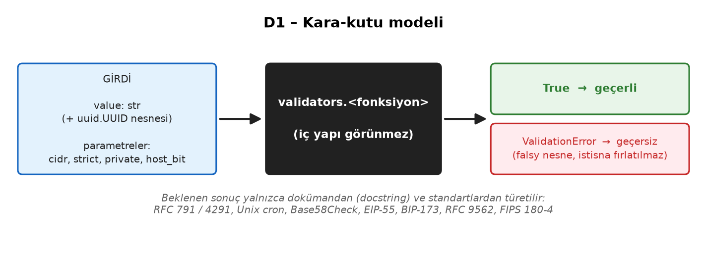
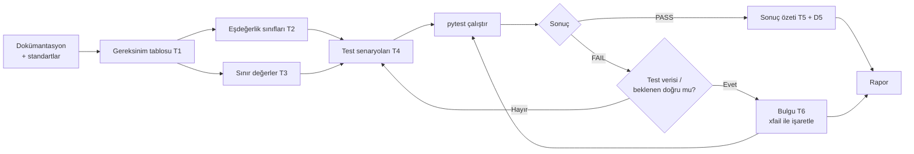
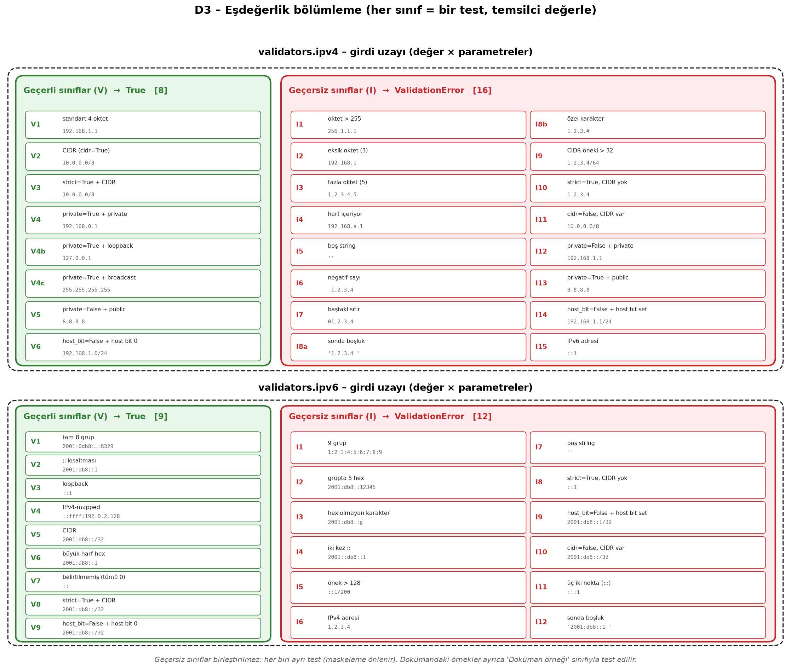
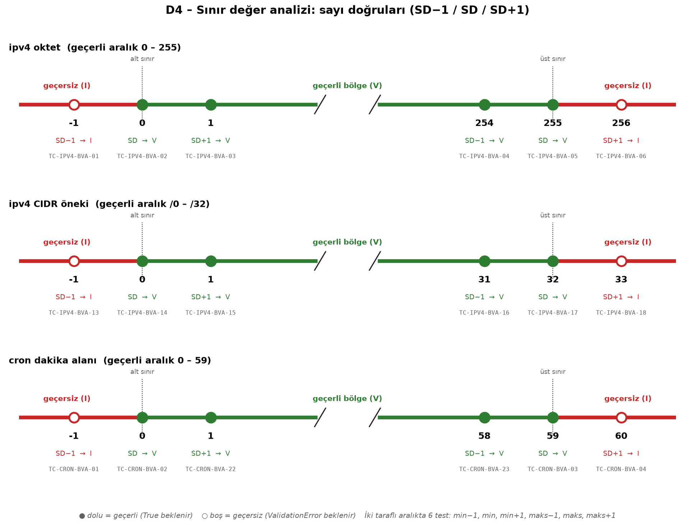
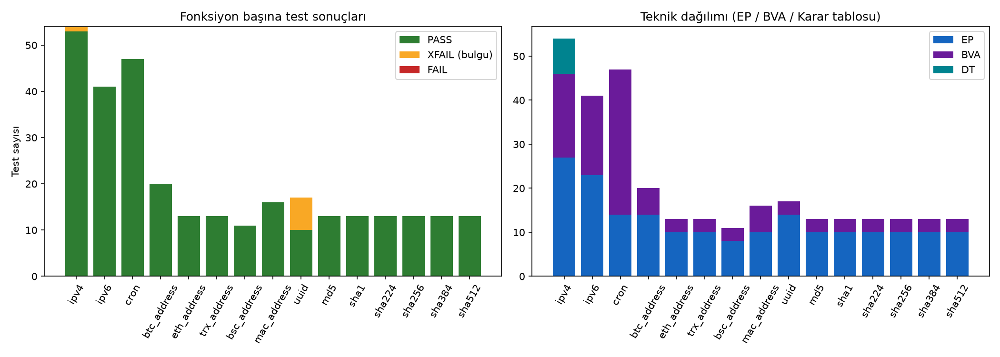

# Kara-Kutu Birim Testi – Network & Crypto Bölümü (pyvalidators)

> **Taslak.** Bu dosya ekibin birleşik raporundaki *Network & Crypto* bölümüdür. Tablolar
> `reports/tablolar.xlsx` ve `docs/tablolar/` dosyalarından otomatik aktarılmıştır
> (oluşturma tarihi: 2026-11-24). `[EKRAN GÖRÜNTÜSÜ …]` ile işaretli yerlere görüntü eklenecek.

---

## 1. Kapsam

Bu bölümde Python `validators` (pyvalidators) kütüphanesinin ağ ve kripto alanındaki
**15 fonksiyonu** kara-kutu yöntemiyle test edilmiştir.

| Ortam | Değer |
|---|---|
| Kütüphane | `validators==0.36.0` (+ `crypto-eth-addresses` ekstrası; `eth_address` için gerekli) |
| Python | 3.14.0 |
| Test çatısı | pytest 9 + pytest-html (JUnit XML + HTML rapor) |
| Ortam yönetimi | `uv` (`pyproject.toml` + `uv.lock` ile tüm sürümler sabit) |

Kütüphanenin davranışı sürümden sürüme değişebileceği için sürüm sabitlenmiştir; ekipteki
herkes aynı sonucu alır.

**Fonksiyonlar, zorluk derecesi ve test sayıları:**

| Fonksiyon | Zorluk (puan) | Test | EP | BVA | DT |
|---|---|---|---|---|---|
| ipv4 | çok zor (5) | 54 | 27 | 19 | 8 |
| ipv6 | çok zor (5) | 41 | 23 | 18 | – |
| cron | zor (3) | 47 | 14 | 33 | – |
| btc_address | zor (3) | 20 | 14 | 6 | – |
| eth_address | zor (3) | 13 | 10 | 3 | – |
| trx_address | zor (3) | 13 | 10 | 3 | – |
| bsc_address | kolay (1) | 11 | 8 | 3 | – |
| mac_address | kolay (1) | 16 | 10 | 6 | – |
| uuid | kolay (1) | 17 | 14 | 3 | – |
| md5, sha1, sha224, sha256, sha384, sha512 | kolay (1'er) | 6 × 13 = 78 | 60 | 18 | – |
| **Toplam** | **31 puan** | **310** | **190** | **112** | **8** |

Test sayısı zorluğa göre dağıtılmıştır: çok zor fonksiyonlara en çok test (ipv4 için ayrıca
karar tablosu), kolay fonksiyonlara daha az test yazılmıştır.

---

## 2. Yöntem

### 2.1 Kara-kutu yaklaşımı

Fonksiyonlar yalnızca **girdi ve çıktıları** üzerinden test edilmiştir (D1).



> **Kaynak koda bakılmamıştır.** Ne `.venv` içindeki kütüphane kodu ne de GitHub'daki kaynak
> kod okunmuştur. Beklenen sonuçlar yalnızca şu kaynaklardan türetilmiştir:
> - kütüphanenin yayımlanmış dokümantasyonu ve fonksiyon docstring'leri (`validators.<fonk>.__doc__`),
> - ilgili standartlar: RFC 791 (IPv4), RFC 4291 (IPv6), Unix cron, Base58Check, EIP-55,
>   BIP-173 (bech32/SegWit), IEEE 802 (MAC), RFC 9562 (UUID), RFC 1321 / FIPS 180-4 (hash).
>
> Başarısız testler de yalnızca fonksiyon çağrılıp docstring okunarak analiz edilmiştir.
> Geçerli kripto test verisi kütüphaneden bağımsız olarak, standartları uygulayan kendi
> üreticilerimizle (`tests/yardimci.py`: `base58check`, `trx_adresi`, `eip55`) doğrulanmıştır.

**Kütüphanenin sözleşmesi:** Geçersiz girdide istisna **fırlatılmaz**; fonksiyon `False` gibi
davranan (falsy) bir `ValidationError` nesnesi **döndürür**. Bu nedenle testlerde
`pytest.raises` kullanılmamış; geçerli girdide `sonuc is True`, geçersiz girdide
`not sonuc` **ve** `isinstance(sonuc, ValidationError)` doğrulanmıştır. İkinci kontrol,
yanlış tipte bir falsy değerin (`False`, `None`) testten kaçmasını önler.

### 2.2 Kullanılan teknikler

- **Eşdeğerlik Bölümleme (EP):** Girdi uzayı, fonksiyonun aynı biçimde işlemesi beklenen
  sınıflara ayrılmış; her sınıftan bir temsilci test edilmiştir. `V` = geçerli, `I` = geçersiz.
  **Geçersiz sınıflar birleştirilmemiştir:** iki kuralı birden bozan bir girdi (ör. `'256.1.1'`)
  reddedildiğinde hangi kuralın çalıştığı anlaşılamaz (maskeleme).
- **Sınır Değer Analizi (BVA):** Her sayısal ve uzunluk sınırı için **SD−1 / SD / SD+1**
  test edilmiştir. İki taraflı aralıklarda (ör. dakika 0–59) altı test vardır:
  min−1, min, min+1, maks−1, maks, maks+1.
- **Karar Tablosu (DT, bonus):** `ipv4`'ün etkileşen boolean parametreleri
  (`cidr` × `strict` × girdide CIDR var mı) için 8 kurallık karar tablosu oluşturulmuştur.
- **Doküman örnekleri:** Her docstring'deki her geçerli/geçersiz örnek ayrı bir test olarak
  eklenmiştir (sınıf: "Doküman örneği").

### 2.3 Test süreci

D2 test sürecini gösterir. Başarısız bir testte önce testin kendisi sorgulanır; test verisi
doküman/standarda göre doğruysa sonuç **bulgu** olarak kaydedilir ve test silinmez.



*D2 – Test süreci akış diyagramı (kaynak: `diyagramlar/D2_test_sureci.mmd`; Word'e eklemek
için mermaid.live üzerinden PNG'ye çevrilebilir).*

---

## 3. Gereksinimler (Tablo 1)

Her satır tek bir kuraldır (`REQ-<FONK>-<no>`). "Kaynak" sütunu kuralın dokümandan mı yoksa
standarttan mı geldiğini gösterir. Son sütun kuralı sınayan testleri listeler (izlenebilirlik
matrisi, bonus). `sonuc_tablosu.py` her çalıştırmada listedeki her ID'nin var olduğunu ve her
testin en az bir gereksinime bağlı olduğunu denetler: **310 testin tamamı 54 gereksinime bağlıdır.**

| ID | Fonksiyon | Gereksinim | Örnek girdi | Beklenen çıktı | Kaynak | Sınayan testler |
|---|---|---|---|---|---|---|
| REQ-IPV4-01 | ipv4 | Adres nokta ile ayrılmış tam 4 oktetten oluşur | '192.168.1' | ValidationError | Standart (RFC 791) | EP-01, EP-10, EP-11, EP-25, BVA-10..12 |
| REQ-IPV4-02 | ipv4 | Her oktet 0–255 aralığında ondalık sayıdır | '256.1.1.1' | ValidationError | Standart (RFC 791), Doküman örneği | EP-09, EP-14, EP-27, BVA-01..09, BVA-19 |
| REQ-IPV4-03 | ipv4 | Yalnızca rakam ve nokta içerir (harf, boşluk, özel karakter yok) | '192.168.a.1' | ValidationError | Standart | EP-12, EP-16, EP-17 |
| REQ-IPV4-04 | ipv4 | Oktetlerde baştaki sıfır reddedilir | '01.2.3.4' | ValidationError | Doküman | EP-15 |
| REQ-IPV4-05 | ipv4 | Boş dize geçersizdir | '' | ValidationError | Doküman | EP-13 |
| REQ-IPV4-06 | ipv4 | cidr=True (varsayılan) iken /0–/32 CIDR öneki kabul edilir | '10.0.0.0/8' | True | Doküman (cidr parametresi) | EP-02, EP-18, EP-26, BVA-13..18 |
| REQ-IPV4-07 | ipv4 | strict=True iken CIDR gösterimi zorunludur | '1.2.3.4' (strict=True) | ValidationError | Doküman (strict parametresi) | EP-03, EP-19, DT-03, DT-04 |
| REQ-IPV4-08 | ipv4 | cidr=False iken CIDR gösterimi kabul edilmez | '10.0.0.0/8' (cidr=False) | ValidationError | Doküman (cidr parametresi) | EP-20, DT-01, DT-02, DT-05..08 |
| REQ-IPV4-09 | ipv4 | private=True yalnız private/local/loopback/broadcast, private=False yalnız public adres kabul eder | '8.8.8.8' (private=True) | ValidationError | Doküman (private parametresi) | EP-04, EP-05, EP-07, EP-08, EP-21, EP-22 |
| REQ-IPV4-10 | ipv4 | host_bit=False iken host bitleri set olan ağ adresi reddedilir | '192.168.1.1/24' (host_bit=False) | ValidationError | Doküman (host_bit parametresi) | EP-06, EP-23 |
| REQ-IPV4-11 | ipv4 | IPv6 adresi IPv4 olarak kabul edilmez | '::1' | ValidationError | Doküman | EP-24 |
| REQ-IPV6-01 | ipv6 | Adres ':' ile ayrılmış 8 gruptan oluşur | '1:2:3:4:5:6:7' | ValidationError | Standart (RFC 4291) | EP-01, EP-10, BVA-01..03 |
| REQ-IPV6-02 | ipv6 | Her grup 1–4 hex karakterdir (büyük/küçük harf serbest) | '::fffff' | ValidationError | Standart (RFC 4291) | EP-06, EP-11, EP-12, BVA-06..08, BVA-15, BVA-16, BVA-18 |
| REQ-IPV6-03 | ipv6 | '::' en fazla bir kez kullanılır ve en az bir sıfır grubunu temsil eder | '2001::db8::1' | ValidationError | Standart (RFC 4291) | EP-02, EP-03, EP-07, EP-13, EP-20, BVA-04, BVA-05, BVA-17 |
| REQ-IPV6-04 | ipv6 | IPv4-mapped IPv6 adresleri kabul edilir | '::ffff:192.0.2.128' | True | Doküman | EP-04 |
| REQ-IPV6-05 | ipv6 | cidr=True iken /0–/128 CIDR öneki kabul edilir | '::1/129' | ValidationError | Doküman (cidr), Standart | EP-05, EP-14, EP-22, BVA-09..14 |
| REQ-IPV6-06 | ipv6 | strict=True CIDR'ı zorunlu kılar, cidr=False CIDR'ı yasaklar | '::1' (strict=True) | ValidationError | Doküman (strict, cidr) | EP-08, EP-17, EP-19 |
| REQ-IPV6-07 | ipv6 | host_bit=False iken host bitleri set olan ağ adresi reddedilir | '2001:db8::1/32' (host_bit=False) | ValidationError | Doküman (host_bit) | EP-09, EP-18 |
| REQ-IPV6-08 | ipv6 | IPv4 adresi, boş dize ve boşluklu dize geçersizdir | 'abc.0.0.1' | ValidationError | Doküman örneği | EP-15, EP-16, EP-21, EP-23 |
| REQ-CRON-01 | cron | İfade boşlukla ayrılmış tam 5 alandan oluşur | '* * * *' | ValidationError | Unix cron (doküman belirtmiyor) | EP-01, EP-07, EP-08, BVA-19..21 |
| REQ-CRON-02 | cron | Dakika alanı 0–59 | '60 * * * *' | ValidationError | Unix cron | EP-09, BVA-01..04, BVA-22, BVA-23 |
| REQ-CRON-03 | cron | Saat alanı 0–23 | '* 24 * * *' | ValidationError | Unix cron | BVA-05..07, BVA-24..26 |
| REQ-CRON-04 | cron | Ayın günü alanı 1–31 | '* * 32 * *' | ValidationError | Unix cron | BVA-08..11, BVA-27, BVA-28 |
| REQ-CRON-05 | cron | Ay alanı 1–12 | '* * * 13 *' | ValidationError | Unix cron | BVA-12..15, BVA-29, BVA-30 |
| REQ-CRON-06 | cron | Haftanın günü alanı 0–7 | '* * * * 8' | ValidationError | Unix cron | EP-05, BVA-16..18, BVA-31..33 |
| REQ-CRON-07 | cron | Alan sözdizimi: *, */n (n≥1), a-b (a≤b), a,b listesi, a-b/n | '30-20 * * * *' | ValidationError | Doküman örneği + Unix cron (GEREKSİNİM BELİRSİZLİĞİ) | EP-02..04, EP-06, EP-10, EP-13, EP-14 |
| REQ-CRON-08 | cron | Geçersiz karakter içeren veya boş ifade geçersizdir | 'a * * * *' | ValidationError | Unix cron | EP-11, EP-12 |
| REQ-BTC-01 | btc_address | Legacy adres 1 (P2PKH) veya 3 (P2SH) ile başlar ve Base58 karakter kümesindedir (0 O I l yok) | '4Cwgr2g7…' | ValidationError | Doküman + Base58Check | EP-01, EP-02, EP-06..09, EP-11 |
| REQ-BTC-02 | btc_address | Legacy adreslerde Base58Check checksum tam doğrulanır | '3Cwgr…FZfC68' | ValidationError | Doküman ('tam doğrulama') | EP-05, EP-14 |
| REQ-BTC-03 | btc_address | SegWit adres bc1/tb1 ile başlar ve bech32 karakter kümesindedir (regex ile tahmin) | 'bx1qar0s…' | ValidationError | Doküman ('regexp ile makul tahmin') + BIP-173 | EP-03, EP-04, EP-10, EP-12 |
| REQ-BTC-04 | btc_address | SegWit veri kısmı 14–74 karakterdir | 'bc1' + 'q'×75 | ValidationError | Test rehberi (regex tahmini) | BVA-01..06 |
| REQ-BTC-05 | btc_address | Boş dize geçersizdir | '' | ValidationError | Doküman | EP-13 |
| REQ-ETH-01 | eth_address | Adres 0x öneki + tam 40 hex karakterdir | '0x' + 'a'×41 | ValidationError | Doküman + EIP-55 | EP-07..09, BVA-01..03 |
| REQ-ETH-02 | eth_address | Tümü küçük veya tümü büyük harfli adres checksum'sız geçerlidir | '0x9cc14ba4…' | True | Doküman örneği + EIP-55 | EP-01, EP-02 |
| REQ-ETH-03 | eth_address | Karışık harfli adreste EIP-55 checksum doğru olmalıdır | '0x8Ba1f1…DBa72' | ValidationError | Doküman örneği + EIP-55 | EP-03..06 |
| REQ-ETH-04 | eth_address | Boş dize geçersizdir | '' | ValidationError | Doküman | EP-10 |
| REQ-TRX-01 | trx_address | Adres büyük 'T' ile başlar | 'ALjfbT…' | ValidationError | Base58Check (sürüm baytı 0x41) | EP-04, EP-05, EP-08 |
| REQ-TRX-02 | trx_address | Adres Base58 karakter kümesindedir (0 O I l yok) | 'TLjfbTbpZY0Q…' | ValidationError | Base58Check | EP-06 |
| REQ-TRX-03 | trx_address | Adres toplam 34 karakterdir | 'TR2G7Rm4…' (33) | ValidationError | Doküman örneği + Base58Check | EP-10, BVA-01..03 |
| REQ-TRX-04 | trx_address | Base58Check checksum doğru olmalıdır | son karakteri değişmiş adres | ValidationError | Doküman ('tam doğrulama') + Base58Check | EP-01..03, EP-07 |
| REQ-TRX-05 | trx_address | Boş dize geçersizdir | '' | ValidationError | Doküman | EP-09 |
| REQ-BSC-01 | bsc_address | Adres 0x öneki + tam 40 hex karakterdir | '0x4g5acf…' | ValidationError | Doküman örneği | EP-01, EP-02, EP-04..06, EP-08, BVA-01..03 |
| REQ-BSC-02 | bsc_address | Checksum denetimi yoktur; karışık harf serbesttir | checksum'ı bozuk karışık adres | True | Test rehberi yorumu (doküman belirtmiyor) | EP-03 |
| REQ-BSC-03 | bsc_address | Boş dize geçersizdir | '' | ValidationError | Doküman | EP-07 |
| REQ-MAC-01 | mac_address | Adres 6 gruptan oluşur, her grup tam 2 hex karakterdir | '00:00:00:00:00' | ValidationError | Doküman örneği + IEEE 802 | EP-01, EP-03, EP-05, EP-10, BVA-01..06 |
| REQ-MAC-02 | mac_address | Ayırıcı ':' veya '-' olur ve karışık kullanılamaz | '01:23-45:67:ab:CD' | ValidationError | Doküman örneği + IEEE 802 | EP-02, EP-04, EP-06..08 |
| REQ-MAC-03 | mac_address | Boş dize geçersizdir | '' | ValidationError | Doküman | EP-09 |
| REQ-UUID-01 | uuid | Dize 8-4-4-4-12 hex biçimindedir (toplam 36 karakter) | '2bc1c94f 0deb-…' | ValidationError | Doküman örneği + RFC 9562 | EP-01, EP-02, EP-05, EP-06, EP-08..11, EP-14, BVA-01..03 |
| REQ-UUID-02 | uuid | UUID sürüm 4 olmalıdır | uuid1() dizesi | ValidationError | Doküman ('UUID-v4 dizesi') | EP-12, EP-13 |
| REQ-UUID-03 | uuid | str ya da uuid.UUID nesnesi kabul edilir | uuid.uuid4() | True | Doküman ('UUID dizesi veya nesnesi') | EP-03, EP-04 |
| REQ-UUID-04 | uuid | Boş dize geçersizdir | '' | ValidationError | Doküman | EP-07 |
| REQ-HASH-01 | md5, sha1, sha224, sha256, sha384, sha512 | Özet tam N hex karakterdir (md5 32, sha1 40, sha224 56, sha256 64, sha384 96, sha512 128) | 'a'×(N+1) | ValidationError | Doküman + RFC 1321 / FIPS 180-4 | EP-01, EP-08, EP-09, BVA-01..03 |
| REQ-HASH-02 | md5, sha1, sha224, sha256, sha384, sha512 | Yalnızca hex karakter içerir; harf büyüklüğü fark etmez | '900zz11' | ValidationError | Doküman örneği | EP-02..06, EP-10 |
| REQ-HASH-03 | md5, sha1, sha224, sha256, sha384, sha512 | Boş dize geçersizdir | '' | ValidationError | Doküman | EP-07 |

**Gereksinim belirsizlikleri** (doküman net değil; varsayım raporda açıkça belirtilmiştir):

1. **cron:** Doküman `*/n`, `a-b`, `a,b` sözdizimini tanımlamıyor. Beklenen sonuçlar standart
   Unix cron davranışına göre yazılmıştır. `-1` değeri, `-` aralık operatörü olduğundan bozuk
   bir aralık olarak da yorumlanabilir.
2. **ipv4 `cidr=False` + `strict=True`:** İki parametre çelişiyor (biri CIDR'ı zorunlu kılar,
   diğeri yasaklar); doküman bu kombinasyonu tanımlamıyor. Karar tablosuyla test edilmiştir
   (BUG-01).
3. **bsc_address:** Dokümanda checksum'dan söz edilmiyor; karışık harfli adresin checksum'sız
   kabul edilmesi tasarım gereği sayılmıştır (TC-BSC-EP-03).
4. **btc_address (SegWit):** Doküman SegWit adreslerinin yalnızca "regexp ile makul tahmin"
   edildiğini söylüyor; veri uzunluğu sınırları (14–74) bu biçim kuralını test eder (GÖZLEM-01).
5. **eth_address:** Test rehberindeki örnek `0x8Ba1f109…DBa72` EIP-55'e göre geçerli bir
   checksum **değildir** (kendi `eip55()` üreticimiz resmî EIP-55 test vektörünü doğru üretiyor).
   Bu yüzden bu test `ValidationError` bekler; kütüphane de reddetmektedir.

---

## 4. Eşdeğerlik sınıfları (Tablo 2, D3)

D3, en karmaşık iki fonksiyonun (ipv4, ipv6) girdi uzayının geçerli ve geçersiz bölgelere
ayrılmasını gösterir. Parametreli sınıflar (ör. `private=False` + private adres) da ayrı
bölgedir; çünkü aynı adres parametreye göre geçerli veya geçersiz olabilir.



Tablo 2 her fonksiyonun sınıflarını ve temsilci değerini verir (V = geçerli, I = geçersiz,
DOK = doküman örneği). Altı hash fonksiyonu yalnızca uzunluk N'de farklılaştığı için tek tabloda
gösterilmiştir (temsilciler md5, N = 32 için).

**Tablo 2.1 – ipv4**


| Sınıf | Açıklama | Temsilci değer | Parametreler | Beklenen | Test ID |
|---|---|---|---|---|---|
| V1 | standart 4 oktet | '192.168.1.1' | — | True | TC-IPV4-EP-01 |
| V2 | CIDR (cidr=True varsayılan) | '10.0.0.0/8' | — | True | TC-IPV4-EP-02 |
| V3 | strict=True + CIDR var | '10.0.0.0/8' | strict=True | True | TC-IPV4-EP-03 |
| V4 | private=True + private | '192.168.0.1' | private=True | True | TC-IPV4-EP-04 |
| V5 | private=False + public | '8.8.8.8' | private=False | True | TC-IPV4-EP-05 |
| V6 | host_bit=False + host bitleri 0 | '192.168.1.0/24' | host_bit=False | True | TC-IPV4-EP-06 |
| V4b | private=True + loopback | '127.0.0.1' | private=True | True | TC-IPV4-EP-07 |
| V4c | private=True + broadcast | '255.255.255.255' | private=True | True | TC-IPV4-EP-08 |
| I1 | oktet > 255 | '256.1.1.1' | — | ValidationError | TC-IPV4-EP-09 |
| I2 | eksik oktet (3) | '192.168.1' | — | ValidationError | TC-IPV4-EP-10 |
| I3 | fazla oktet (5) | '1.2.3.4.5' | — | ValidationError | TC-IPV4-EP-11 |
| I4 | harf içeriyor | '192.168.a.1' | — | ValidationError | TC-IPV4-EP-12 |
| I5 | boş string | '' | — | ValidationError | TC-IPV4-EP-13 |
| I6 | negatif sayı | '-1.2.3.4' | — | ValidationError | TC-IPV4-EP-14 |
| I7 | baştaki sıfır | '01.2.3.4' | — | ValidationError | TC-IPV4-EP-15 |
| I8a | sonda boşluk | '1.2.3.4 ' | — | ValidationError | TC-IPV4-EP-16 |
| I8b | özel karakter | '1.2.3.#' | — | ValidationError | TC-IPV4-EP-17 |
| I9 | CIDR öneki > 32 | '1.2.3.4/64' | — | ValidationError | TC-IPV4-EP-18 |
| I10 | strict=True ama CIDR yok | '1.2.3.4' | strict=True | ValidationError | TC-IPV4-EP-19 |
| I11 | cidr=False ama CIDR var | '10.0.0.0/8' | cidr=False | ValidationError | TC-IPV4-EP-20 |
| I12 | private=False + private | '192.168.1.1' | private=False | ValidationError | TC-IPV4-EP-21 |
| I13 | private=True + public | '8.8.8.8' | private=True | ValidationError | TC-IPV4-EP-22 |
| I14 | host_bit=False + host bitleri set | '192.168.1.1/24' | host_bit=False | ValidationError | TC-IPV4-EP-23 |
| I15 | IPv6 adresi | '::1' | — | ValidationError | TC-IPV4-EP-24 |
| DOK | Doküman örneği (geçerli) | '123.0.0.7' | — | True | TC-IPV4-EP-25 |
| DOK | Doküman örneği (geçerli, CIDR) | '1.1.1.1/8' | — | True | TC-IPV4-EP-26 |
| DOK | Doküman örneği (geçersiz) | '900.80.70.11' | — | ValidationError | TC-IPV4-EP-27 |

**Tablo 2.2 – ipv6**


| Sınıf | Açıklama | Temsilci değer | Parametreler | Beklenen | Test ID |
|---|---|---|---|---|---|
| V1 | tam 8 grup | '2001:0db8:0000:0000:0000:ff00:0042:8329' | — | True | TC-IPV6-EP-01 |
| V2 | :: kısaltması | '2001:db8::1' | — | True | TC-IPV6-EP-02 |
| V3 | loopback | '::1' | — | True | TC-IPV6-EP-03 |
| V4 | IPv4-mapped | '::ffff:192.0.2.128' | — | True | TC-IPV6-EP-04 |
| V5 | CIDR | '2001:db8::/32' | — | True | TC-IPV6-EP-05 |
| V6 | büyük harf hex | '2001:DB8::1' | — | True | TC-IPV6-EP-06 |
| V7 | belirtilmemiş adres (tümü sıfır) | '::' | — | True | TC-IPV6-EP-07 |
| V8 | strict=True + CIDR var | '2001:db8::/32' | strict=True | True | TC-IPV6-EP-08 |
| V9 | host_bit=False + host bitleri 0 | '2001:db8::/32' | host_bit=False | True | TC-IPV6-EP-09 |
| I1 | 9 grup | '1:2:3:4:5:6:7:8:9' | — | ValidationError | TC-IPV6-EP-10 |
| I2 | grupta 5 hex | '2001:db8::12345' | — | ValidationError | TC-IPV6-EP-11 |
| I3 | hex olmayan karakter | '2001:db8::g' | — | ValidationError | TC-IPV6-EP-12 |
| I4 | iki kez :: | '2001::db8::1' | — | ValidationError | TC-IPV6-EP-13 |
| I5 | önek > 128 | '::1/200' | — | ValidationError | TC-IPV6-EP-14 |
| I6 | IPv4 adresi | '1.2.3.4' | — | ValidationError | TC-IPV6-EP-15 |
| I7 | boş string | '' | — | ValidationError | TC-IPV6-EP-16 |
| I8 | strict=True ama CIDR yok | '::1' | strict=True | ValidationError | TC-IPV6-EP-17 |
| I9 | host_bit=False + host bitleri set | '2001:db8::1/32' | host_bit=False | ValidationError | TC-IPV6-EP-18 |
| I10 | cidr=False ama CIDR var | '2001:db8::/32' | cidr=False | ValidationError | TC-IPV6-EP-19 |
| I11 | üç iki nokta (:::) | ':::1' | — | ValidationError | TC-IPV6-EP-20 |
| I12 | sonda boşluk | '2001:db8::1 ' | — | ValidationError | TC-IPV6-EP-21 |
| DOK | Doküman örneği (geçerli, CIDR) | '::1/128' | — | True | TC-IPV6-EP-22 |
| DOK | Doküman örneği (geçersiz) | 'abc.0.0.1' | — | ValidationError | TC-IPV6-EP-23 |

**Tablo 2.3 – cron**


| Sınıf | Açıklama | Temsilci değer | Parametreler | Beklenen | Test ID |
|---|---|---|---|---|---|
| V1 | tüm alanlar * | '* * * * *' | — | True | TC-CRON-EP-01 |
| V2 | adım */n | '*/5 * * * *' | — | True | TC-CRON-EP-02 |
| V3 | aralık a-b | '0-30 9-17 * * 1-5' | — | True | TC-CRON-EP-03 |
| V4 | liste a,b | '0,15,30 * * * *' | — | True | TC-CRON-EP-04 |
| V5 | tam sayılar | '30 6 15 8 3' | — | True | TC-CRON-EP-05 |
| V6 | aralık + adım a-b/n | '0-59/15 * * * *' | — | True | TC-CRON-EP-06 |
| I1 | alan sayısı az (3) | '* * *' | — | ValidationError | TC-CRON-EP-07 |
| I2 | alan sayısı fazla (7) | '* * * * * * *' | — | ValidationError | TC-CRON-EP-08 |
| I3 | dakika aralık dışı | '75 * * * *' | — | ValidationError | TC-CRON-EP-09 |
| I4 | ters aralık | '30-20 * * * *' | — | ValidationError | TC-CRON-EP-10 |
| I5 | harf / geçersiz karakter | 'a * * * *' | — | ValidationError | TC-CRON-EP-11 |
| I6 | boş string | '' | — | ValidationError | TC-CRON-EP-12 |
| I7 | adım sıfır | '*/0 * * * *' | — | ValidationError | TC-CRON-EP-13 |
| I8 | listede boş eleman | '1,,2 * * * *' | — | ValidationError | TC-CRON-EP-14 |

**Tablo 2.4 – btc_address**


| Sınıf | Açıklama | Temsilci değer | Parametreler | Beklenen | Test ID |
|---|---|---|---|---|---|
| V1 | legacy P2SH (3...) | '3Cwgr2g7vsi1bXDUkpEnVoRLA9w4FZfC69' | — | True | TC-BTC-EP-01 |
| V2 | legacy P2PKH (1...) | '1BvBMSEYstWetqTFn5Au4m4GFg7xJaNVN2' | — | True | TC-BTC-EP-02 |
| V3 | SegWit mainnet (bc1...) | 'bc1qar0srrr7xfkvy5l643lydnw9re59gtzzwf5mdq' | — | True | TC-BTC-EP-03 |
| V4 | SegWit testnet (tb1...) | 'tb1qw508d6qejxtdg4y5r3zarvary0c5xw7kxpjzsx' | — | True | TC-BTC-EP-04 |
| I1 | checksum bozuk (son harf) | '3Cwgr2g7vsi1bXDUkpEnVoRLA9w4FZfC68' | — | ValidationError | TC-BTC-EP-05 |
| I2a | Base58 dışı '0' | '3Cwgr2g7vs01bXDUkpEnVoRLA9w4FZfC69' | — | ValidationError | TC-BTC-EP-06 |
| I2b | Base58 dışı 'O' | '3Cwgr2g7vsO1bXDUkpEnVoRLA9w4FZfC69' | — | ValidationError | TC-BTC-EP-07 |
| I2c | Base58 dışı 'I' | '3Cwgr2g7vsI1bXDUkpEnVoRLA9w4FZfC69' | — | ValidationError | TC-BTC-EP-08 |
| I2d | Base58 dışı 'l' | '3Cwgr2g7vsl1bXDUkpEnVoRLA9w4FZfC69' | — | ValidationError | TC-BTC-EP-09 |
| I3 | SegWit veri kısmında 'b' | 'bc1qar0srrb7xfkvy5l643lydnw9re59gtzzwf5mdq' | — | ValidationError | TC-BTC-EP-10 |
| I4 | yanlış önek (4...) | '4Cwgr2g7vsi1bXDUkpEnVoRLA9w4FZfC69' | — | ValidationError | TC-BTC-EP-11 |
| I5 | yanlış SegWit HRP (bx1...) | 'bx1qar0srrr7xfkvy5l643lydnw9re59gtzzwf5mdq' | — | ValidationError | TC-BTC-EP-12 |
| I6 | boş string | '' | — | ValidationError | TC-BTC-EP-13 |
| DOK | Doküman örneği (geçersiz; EP-02'deki adresin tek harfi küçük) | '1BvBMsEYstWetqTFn5Au4m4GFg7xJaNVN2' | — | ValidationError | TC-BTC-EP-14 |

**Tablo 2.5 – eth_address**


| Sınıf | Açıklama | Temsilci değer | Parametreler | Beklenen | Test ID |
|---|---|---|---|---|---|
| V1 | tümü küçük harf | '0x9cc14ba4f9f68ca159ea4ebf2c292a808aaeb598' | — | True | TC-ETH-EP-01 |
| V2 | tümü büyük harf | '0x9CC14BA4F9F68CA159EA4EBF2C292A808AAEB598' | — | True | TC-ETH-EP-02 |
| V3 | doğru EIP-55 checksum | '0x5aAeb6053F3E94C9b9A09f33669435E7Ef1BeAed' | — | True | TC-ETH-EP-03 |
| V4 | doğru EIP-55 (doküman adresinden üretildi) | '0x9Cc14Ba4F9f68CA159ea4eBf2C292A808aAeb598' | — | True | TC-ETH-EP-04 |
| I1 | bozuk checksum (bir harf küçültüldü) | '0x5aaeb6053F3E94C9b9A09f33669435E7Ef1BeAed' | — | ValidationError | TC-ETH-EP-05 |
| I1b | checksum'ı EIP-55'e uymayan karışık adres | '0x8Ba1f109551bD432803012645Ac136ddd64DBa72' | — | ValidationError | TC-ETH-EP-06 |
| I2 | 0x öneki yok | '9cc14ba4f9f68ca159ea4ebf2c292a808aaeb598' | — | ValidationError | TC-ETH-EP-07 |
| I3 | hex olmayan karakter | '0x9gc14ba4f9f68ca159ea4ebf2c292a808aaeb598' | — | ValidationError | TC-ETH-EP-08 |
| I4 | büyük 0X öneki | '0X9cc14ba4f9f68ca159ea4ebf2c292a808aaeb598' | — | ValidationError | TC-ETH-EP-09 |
| I5 | boş string | '' | — | ValidationError | TC-ETH-EP-10 |

**Tablo 2.6 – trx_address**


| Sınıf | Açıklama | Temsilci değer | Parametreler | Beklenen | Test ID |
|---|---|---|---|---|---|
| V1 | geçerli (doküman) | 'TLjfbTbpZYDQ4EoA4N5CLNgGjfbF8ZWz38' | — | True | TC-TRX-EP-01 |
| V2 | geçerli (bilinen adres) | 'TR7NHqjeKQxGTCi8q8ZY4pL8otSzgjLj6t' | — | True | TC-TRX-EP-02 |
| V3 | geçerli (Base58Check ile üretildi) | 'T9yED5xMV5ARV98BexN97aLZ1UUq7eKSxm' | — | True | TC-TRX-EP-03 |
| I1 | T ile başlamıyor | 'ALjfbTbpZYDQ4EoA4N5CLNgGjfbF8ZWz38' | — | ValidationError | TC-TRX-EP-04 |
| I1b | küçük t ile başlıyor | 'tLjfbTbpZYDQ4EoA4N5CLNgGjfbF8ZWz38' | — | ValidationError | TC-TRX-EP-05 |
| I2 | Base58 dışı karakter | 'TLjfbTbpZY0Q4EoA4N5CLNgGjfbF8ZWz38' | — | ValidationError | TC-TRX-EP-06 |
| I3 | checksum bozuk (son karakter) | 'TLjfbTbpZYDQ4EoA4N5CLNgGjfbF8ZWz39' | — | ValidationError | TC-TRX-EP-07 |
| I4 | BTC adresi | '1BvBMSEYstWetqTFn5Au4m4GFg7xJaNVN2' | — | ValidationError | TC-TRX-EP-08 |
| I5 | boş string | '' | — | ValidationError | TC-TRX-EP-09 |
| DOK | Doküman örneği (geçersiz, 33 karakter) | 'TR2G7Rm4vFqF8EpY4U5xdLdQ7XgJ2U8Vd' | — | ValidationError | TC-TRX-EP-10 |

**Tablo 2.7 – bsc_address**


| Sınıf | Açıklama | Temsilci değer | Parametreler | Beklenen | Test ID |
|---|---|---|---|---|---|
| V1 | geçerli (karışık harf) | '0x4e5acf9684652BEa56F2f01b7101a225Ee33d23f' | — | True | TC-BSC-EP-01 |
| V2 | tümü küçük harf | '0x4e5acf9684652bea56f2f01b7101a225ee33d23f' | — | True | TC-BSC-EP-02 |
| V3 | checksum'ı bozuk karışık harf (BSC'de checksum yok, tasarım gereği) | '0xEe5acf9684652BEa56F2f01b7101a225Ee33d23f' | — | True | TC-BSC-EP-03 |
| I1 | hex olmayan | '0x4g5acf9684652BEa56F2f01b7101a225Ee33d23f' | — | ValidationError | TC-BSC-EP-04 |
| I2 | 0x öneki yok | '4e5acf9684652BEa56F2f01b7101a225Ee33d23f' | — | ValidationError | TC-BSC-EP-05 |
| I3 | büyük 0X öneki | '0X4e5acf9684652BEa56F2f01b7101a225Ee33d23f' | — | ValidationError | TC-BSC-EP-06 |
| I4 | boş string | '' | — | ValidationError | TC-BSC-EP-07 |
| DOK | Doküman örneği (geçersiz) | '0x4g5acf9684652BEa56F2f01b7101a225Eh33d23z' | — | ValidationError | TC-BSC-EP-08 |

**Tablo 2.8 – mac_address**


| Sınıf | Açıklama | Temsilci değer | Parametreler | Beklenen | Test ID |
|---|---|---|---|---|---|
| V1 | ':' ayırıcı | '01:23:45:67:ab:CD' | — | True | TC-MAC-EP-01 |
| V2 | '-' ayırıcı | '01-23-45-67-AB-CD' | — | True | TC-MAC-EP-02 |
| V3 | tümü küçük harf | '01:23:45:67:ab:cd' | — | True | TC-MAC-EP-03 |
| I1 | karışık ayırıcı | '01:23-45:67:ab:CD' | — | ValidationError | TC-MAC-EP-04 |
| I2 | hex olmayan | 'GG:23:45:67:ab:CD' | — | ValidationError | TC-MAC-EP-05 |
| I3 | ayırıcısız | '0123456789AB' | — | ValidationError | TC-MAC-EP-06 |
| I4 | Cisco formatı | '0123.4567.89ab' | — | ValidationError | TC-MAC-EP-07 |
| I5 | '.' ayırıcı | '01.23.45.67.ab.cd' | — | ValidationError | TC-MAC-EP-08 |
| I6 | boş string | '' | — | ValidationError | TC-MAC-EP-09 |
| DOK | Doküman örneği (geçersiz, 5 grup) | '00:00:00:00:00' | — | ValidationError | TC-MAC-EP-10 |

**Tablo 2.9 – uuid**


| Sınıf | Açıklama | Temsilci değer | Parametreler | Beklenen | Test ID |
|---|---|---|---|---|---|
| V1 | standart string | '2bc1c94f-0deb-43e9-92a1-4775189ec9f8' | — | True | TC-UUID-EP-01 |
| V2 | büyük harf | '2BC1C94F-0DEB-43E9-92A1-4775189EC9F8' | — | True | TC-UUID-EP-02 |
| V3 | uuid.UUID nesnesi (uuid4) | UUID('00ab63a1-d362-4524-8b28-44a6f61cd011') | — | True | TC-UUID-EP-03 |
| V4 | uuid.UUID nesnesi (sabit) | UUID('2bc1c94f-0deb-43e9-92a1-4775189ec9f8') | — | True | TC-UUID-EP-04 |
| I1 | tire yerine boşluk | '2bc1c94f 0deb-43e9-92a1-4775189ec9f8' | — | ValidationError | TC-UUID-EP-05 |
| I2 | hex olmayan | 'zbc1c94f-0deb-43e9-92a1-4775189ec9f8' | — | ValidationError | TC-UUID-EP-06 |
| I3 | boş string | '' | — | ValidationError | TC-UUID-EP-07 |
| I4 | tiresiz 32 hex | '2bc1c94f0deb43e992a14775189ec9f8' | — | ValidationError | TC-UUID-EP-08 |
| I5 | süslü parantezli | '{2bc1c94f-0deb-43e9-92a1-4775189ec9f8}' | — | ValidationError | TC-UUID-EP-09 |
| I6 | urn:uuid: önekli | 'urn:uuid:2bc…' (45 karakter) | — | ValidationError | TC-UUID-EP-10 |
| I7 | tire konumu yanlış | '2bc1c94f0-deb-43e9-92a1-4775189ec9f8' | — | ValidationError | TC-UUID-EP-11 |
| I8 | UUID v1 (doküman v4 diyor) | 'c01e6940-da3f-11f1-8a43-d843ae7f0e48' | — | ValidationError | TC-UUID-EP-12 |
| I9 | nil UUID (sürüm 0) | '00000000-0000-0000-0000-000000000000' | — | ValidationError | TC-UUID-EP-13 |
| I10 | tireler rastgele konumda | '2-b-c-1c94f0deb43e992a14775189ec9f8' | — | ValidationError | TC-UUID-EP-14 |

**Tablo 2.10 – 6 hash (N)**


| Sınıf | Açıklama | Temsilci değer | Parametreler | Beklenen | Test ID |
|---|---|---|---|---|---|
| V1 | N adet küçük hex | 'aaaaaaaaaaaa…' (32 karakter)  ← md5 için | — | True | TC-<HASH>-EP-01 |
| V2 | N adet karışık harf hex | 'aBaBaBaBaBaB…' (32 karakter)  ← md5 için | — | True | TC-<HASH>-EP-02 |
| V3 | rakam + harf hex | '0123456789ab…' (32 karakter)  ← md5 için | — | True | TC-<HASH>-EP-03 |
| I1 | hex olmayan karakter | 'gaaaaaaaaaaa…' (32 karakter)  ← md5 için | — | ValidationError | TC-<HASH>-EP-04 |
| I3 | 0x öneki | '0xaaaaaaaaaa…' (34 karakter)  ← md5 için | — | ValidationError | TC-<HASH>-EP-05 |
| I4 | boşluk içeriyor | ' aaaaaaaaaaa…' (33 karakter)  ← md5 için | — | ValidationError | TC-<HASH>-EP-06 |
| I5 | boş string | ''  ← md5 için | — | ValidationError | TC-<HASH>-EP-07 |
| I2 | başka algoritmanın uzunluğu (sha1, 40) | 'aaaaaaaaaaaa…' (40 karakter)  ← md5 için | — | ValidationError | TC-<HASH>-EP-08 |
| DOK | Doküman örneği (geçerli, gerçek özet) | 'd41d8cd98f00…' (32 karakter)  ← md5 için | — | True | TC-<HASH>-EP-09 |
| DOK | Doküman örneği (geçersiz) | '900zz11'  ← md5 için | — | ValidationError | TC-<HASH>-EP-10 |

---

## 5. Sınır değer analizi (Tablo 3, D4)

D4, üç sayısal sınırı sayı doğrusu üzerinde gösterir: ipv4 okteti (0–255), ipv4 CIDR öneki
(/0–/32) ve cron dakika alanı (0–59). Sınırlar hem alt hem üst uçta SD−1 / SD / SD+1 ile
test edilmiştir.



Sınırlar iki türdür:
- **Sayısal değer sınırları:** oktet, CIDR öneki (ipv4 /32, ipv6 /128), cron alanları
  (dakika, saat, gün, ay, haftanın günü).
- **Uzunluk sınırları:** ipv6 grup sayısı (8) ve grup uzunluğu (4 hex), eth/bsc hex uzunluğu (40),
  trx uzunluğu (34), MAC grup sayısı (6) ve grup uzunluğu (2), uuid uzunluğu (36), hash uzunluğu N.

ipv4'te üst sınır hem **ilk** hem **son** oktette test edilmiştir; sınırın her konumda
uygulandığı böylece doğrulanır.

| Fonksiyon | Sınır | SD−1 | SD | SD+1 | Beklenen (SD−1 / SD / SD+1) | Test ID'ler |
|---|---|---|---|---|---|---|
| ipv4 | Oktet alt | '-1.0.0.0' | '0.0.0.0' | '1.0.0.0' | I / V / V | TC-IPV4-BVA-01, TC-IPV4-BVA-02, TC-IPV4-BVA-03 |
| ipv4 | Oktet üst | '254.1.1.1' | '255.1.1.1' | '256.1.1.1' | V / V / I | TC-IPV4-BVA-04, TC-IPV4-BVA-05, TC-IPV4-BVA-06 |
| ipv4 | Son oktet üst | '1.1.1.254' | '1.1.1.255' | '1.1.1.256' | V / V / I | TC-IPV4-BVA-07, TC-IPV4-BVA-08, TC-IPV4-BVA-19 |
| ipv4 | Tüm oktetler maks | — | '255.255.255.255' | — | — / V / — | TC-IPV4-BVA-09 |
| ipv4 | Oktet sayısı | '1.2.3' | '1.2.3.4' | '1.2.3.4.5' | I / V / I | TC-IPV4-BVA-10, TC-IPV4-BVA-11, TC-IPV4-BVA-12 |
| ipv4 | CIDR alt | '1.2.3.4/-1' | '1.2.3.4/0' | '1.2.3.4/1' | I / V / V | TC-IPV4-BVA-13, TC-IPV4-BVA-14, TC-IPV4-BVA-15 |
| ipv4 | CIDR üst | '1.2.3.4/31' | '1.2.3.4/32' | '1.2.3.4/33' | V / V / I | TC-IPV4-BVA-16, TC-IPV4-BVA-17, TC-IPV4-BVA-18 |
| ipv6 | Grup sayısı | '1:2:3:4:5:6:7' | '1:2:3:4:5:6:7:8' | '1:2:3:4:5:6:7:8:9' | I / V / I | TC-IPV6-BVA-01, TC-IPV6-BVA-02, TC-IPV6-BVA-03 |
| ipv6 | :: ile açık grup sayısı | '1::3:4:5:6:7' | '1::2:3:4:5:6:7' | '1:2:3:4:5:6:7:8::' | V / V / I | TC-IPV6-BVA-04, TC-IPV6-BVA-05, TC-IPV6-BVA-17 |
| ipv6 | Grup uzunluğu | '::fff' | '::ffff' | '::fffff' | V / V / I | TC-IPV6-BVA-06, TC-IPV6-BVA-07, TC-IPV6-BVA-08 |
| ipv6 | CIDR alt | '::1/-1' | '::1/0' | '::1/1' | I / V / V | TC-IPV6-BVA-09, TC-IPV6-BVA-10, TC-IPV6-BVA-11 |
| ipv6 | CIDR üst | '::1/127' | '::1/128' | '::1/129' | V / V / I | TC-IPV6-BVA-12, TC-IPV6-BVA-13, TC-IPV6-BVA-14 |
| ipv6 | Hex harf sınırı | '::e' | '::f' | '::g' | V / V / I | TC-IPV6-BVA-15, TC-IPV6-BVA-16, TC-IPV6-BVA-18 |
| cron | Dakika alt | '-1 * * * *' | '0 * * * *' | '1 * * * *' | I / V / V | TC-CRON-BVA-01, TC-CRON-BVA-02, TC-CRON-BVA-22 |
| cron | Dakika üst | '58 * * * *' | '59 * * * *' | '60 * * * *' | V / V / I | TC-CRON-BVA-03, TC-CRON-BVA-04, TC-CRON-BVA-23 |
| cron | Saat alt | '* -1 * * *' | '* 0 * * *' | '* 1 * * *' | I / V / V | TC-CRON-BVA-05, TC-CRON-BVA-24, TC-CRON-BVA-25 |
| cron | Saat üst | '* 22 * * *' | '* 23 * * *' | '* 24 * * *' | V / V / I | TC-CRON-BVA-06, TC-CRON-BVA-07, TC-CRON-BVA-26 |
| cron | Gün alt | '* * 0 * *' | '* * 1 * *' | '* * 2 * *' | I / V / V | TC-CRON-BVA-08, TC-CRON-BVA-09, TC-CRON-BVA-27 |
| cron | Gün üst | '* * 30 * *' | '* * 31 * *' | '* * 32 * *' | V / V / I | TC-CRON-BVA-10, TC-CRON-BVA-11, TC-CRON-BVA-28 |
| cron | Ay alt | '* * * 0 *' | '* * * 1 *' | '* * * 2 *' | I / V / V | TC-CRON-BVA-12, TC-CRON-BVA-13, TC-CRON-BVA-29 |
| cron | Ay üst | '* * * 11 *' | '* * * 12 *' | '* * * 13 *' | V / V / I | TC-CRON-BVA-14, TC-CRON-BVA-15, TC-CRON-BVA-30 |
| cron | Haftanın günü alt | '* * * * -1' | '* * * * 0' | '* * * * 1' | I / V / V | TC-CRON-BVA-16, TC-CRON-BVA-31, TC-CRON-BVA-32 |
| cron | Haftanın günü üst | '* * * * 6' | '* * * * 7' | '* * * * 8' | V / V / I | TC-CRON-BVA-17, TC-CRON-BVA-18, TC-CRON-BVA-33 |
| cron | Alan sayısı | '* * * *' | '* * * * *' | '* * * * * *' | I / V / I | TC-CRON-BVA-19, TC-CRON-BVA-20, TC-CRON-BVA-21 |
| btc_address | SegWit veri alt | 'bc1qqqqqqqqqqqqq' | 'bc1qqqqqqqqqqqqqq' | 'bc1qqqqqqqqqqqqqqq' | I / V / V | TC-BTC-BVA-01, TC-BTC-BVA-02, TC-BTC-BVA-05 |
| btc_address | SegWit veri üst | 'bc1qqqqqqqqq…' (76 karakter)  → sınır değeri (73) | 'bc1qqqqqqqqq…' (77 karakter)  → sınır değeri (74) | 'bc1qqqqqqqqq…' (78 karakter)  → sınır değeri (75) | V / V / I | TC-BTC-BVA-03, TC-BTC-BVA-04, TC-BTC-BVA-06 |
| eth_address | Hex uzunluğu | '0xaaaaaaaaaa…' (41 karakter)  → sınır değeri (39) | '0xaaaaaaaaaa…' (42 karakter)  → sınır değeri (40) | '0xaaaaaaaaaa…' (43 karakter)  → sınır değeri (41) | I / V / I | TC-ETH-BVA-01, TC-ETH-BVA-02, TC-ETH-BVA-03 |
| trx_address | Uzunluk | 'TLjfbTbpZYDQ…' (33 karakter)  → sınır değeri (33) | 'TLjfbTbpZYDQ…' (34 karakter)  → sınır değeri (34) | 'TLjfbTbpZYDQ…' (35 karakter)  → sınır değeri (35) | I / V / I | TC-TRX-BVA-01, TC-TRX-BVA-02, TC-TRX-BVA-03 |
| bsc_address | Hex uzunluğu | '0xaaaaaaaaaa…' (41 karakter)  → sınır değeri (39) | '0xaaaaaaaaaa…' (42 karakter)  → sınır değeri (40) | '0xaaaaaaaaaa…' (43 karakter)  → sınır değeri (41) | I / V / I | TC-BSC-BVA-01, TC-BSC-BVA-02, TC-BSC-BVA-03 |
| mac_address | Grup sayısı | '01:23:45:67:89' | '01:23:45:67:89:ab' | '01:23:45:67:89:ab:cd' | I / V / I | TC-MAC-BVA-01, TC-MAC-BVA-02, TC-MAC-BVA-03 |
| mac_address | Grup uzunluğu | '1:23:45:67:89:ab' | '01:23:45:67:89:AB' | '001:23:45:67:89:ab' | I / V / I | TC-MAC-BVA-04, TC-MAC-BVA-05, TC-MAC-BVA-06 |
| uuid | Uzunluk | '2bc1c94f-0de…' (35 karakter)  → sınır değeri (35) | '2bc1c94f-0de…' (36 karakter)  → sınır değeri (36) | '2bc1c94f-0de…' (37 karakter)  → sınır değeri (37) | I / V / I | TC-UUID-BVA-01, TC-UUID-BVA-02, TC-UUID-BVA-03 |
| md5 | Uzunluk | 'aaaaaaaaaaaa…' (31 karakter) | 'aaaaaaaaaaaa…' (32 karakter) | 'aaaaaaaaaaaa…' (33 karakter) | I / V / I | TC-MD5-BVA-01, TC-MD5-BVA-02, TC-MD5-BVA-03 |
| sha1 | Uzunluk | 'aaaaaaaaaaaa…' (39 karakter) | 'aaaaaaaaaaaa…' (40 karakter) | 'aaaaaaaaaaaa…' (41 karakter) | I / V / I | TC-SHA1-BVA-01, TC-SHA1-BVA-02, TC-SHA1-BVA-03 |
| sha224 | Uzunluk | 'aaaaaaaaaaaa…' (55 karakter) | 'aaaaaaaaaaaa…' (56 karakter) | 'aaaaaaaaaaaa…' (57 karakter) | I / V / I | TC-SHA224-BVA-01, TC-SHA224-BVA-02, TC-SHA224-BVA-03 |
| sha256 | Uzunluk | 'aaaaaaaaaaaa…' (63 karakter) | 'aaaaaaaaaaaa…' (64 karakter) | 'aaaaaaaaaaaa…' (65 karakter) | I / V / I | TC-SHA256-BVA-01, TC-SHA256-BVA-02, TC-SHA256-BVA-03 |
| sha384 | Uzunluk | 'aaaaaaaaaaaa…' (95 karakter) | 'aaaaaaaaaaaa…' (96 karakter) | 'aaaaaaaaaaaa…' (97 karakter) | I / V / I | TC-SHA384-BVA-01, TC-SHA384-BVA-02, TC-SHA384-BVA-03 |
| sha512 | Uzunluk | 'aaaaaaaaaaaa…' (127 karakter) | 'aaaaaaaaaaaa…' (128 karakter) | 'aaaaaaaaaaaa…' (129 karakter) | I / V / I | TC-SHA512-BVA-01, TC-SHA512-BVA-02, TC-SHA512-BVA-03 |

**Karar tablosu (bonus, ipv4):**

| Kural | cidr | strict | Girdide CIDR | Girdi | Beklenen | Gerçekleşen | Test ID |
|---|---|---|---|---|---|---|---|
| R1 | T | F | yok | `1.2.3.4` | V | V | TC-IPV4-DT-01 |
| R2 | T | F | var | `1.2.3.0/24` | V | V | TC-IPV4-DT-02 |
| R3 | T | T | yok | `1.2.3.4` | I | I | TC-IPV4-DT-03 |
| R4 | T | T | var | `1.2.3.0/24` | V | V | TC-IPV4-DT-04 |
| R5 | F | F | yok | `1.2.3.4` | V | V | TC-IPV4-DT-05 |
| R6 | F | F | var | `1.2.3.0/24` | I | I | TC-IPV4-DT-06 |
| **R7** | F | T | yok | `1.2.3.4` | I | **V (BUG-01)** | TC-IPV4-DT-07 |
| R8 | F | T | var | `1.2.3.0/24` | I | I | TC-IPV4-DT-08 |

---

## 6. Test senaryoları (Tablo 4)

310 senaryonun tamamı `reports/tablolar.xlsx` dosyasında, iki sayfa halinde **ektedir**:
- **T4a Test Senaryoları:** tasarım aşaması (Test ID, gereksinim, girdi, parametreler, teknik,
  sınıf, beklenen). Gerçekleşen ve Durum sütunları boştur.
- **T4b Test Sonuçları:** aynı tablo, Gerçekleşen ve Durum sütunları pytest çıktısından
  **otomatik** doldurulmuş hâliyle. Bu sütunlar elle yazılmamıştır.

Test ID biçimi `TC-<FONK>-<EP|BVA|DT>-<no>`'dur. Aynı ID kodda (`pytest.param(..., id=...)`),
konsol çıktısında, HTML raporda ve tablolarda birebir aynıdır.

Örnek kesit (ipv4):

| Test ID | Fonksiyon | Gereksinim | Girdi | Parametreler | Teknik | Sınıf / Sınır | Beklenen | Gerçekleşen | Durum | Not |
|---|---|---|---|---|---|---|---|---|---|---|
| TC-IPV4-EP-01 | ipv4 | REQ-IPV4-01 | '192.168.1.1' | — | EP | V1 standart 4 oktet | True | True | PASS |  |
| TC-IPV4-EP-09 | ipv4 | REQ-IPV4-02 | '256.1.1.1' | — | EP | I1 oktet > 255 | ValidationError | ValidationError | PASS |  |
| TC-IPV4-EP-21 | ipv4 | REQ-IPV4-09 | '192.168.1.1' | private=False | EP | I12 private=False + private | ValidationError | ValidationError | PASS |  |
| TC-IPV4-BVA-05 | ipv4 | REQ-IPV4-02 | '255.1.1.1' | — | BVA | Oktet üst SD | True | True | PASS |  |
| TC-IPV4-BVA-06 | ipv4 | REQ-IPV4-02 | '256.1.1.1' | — | BVA | Oktet üst SD+1 | ValidationError | ValidationError | PASS |  |
| TC-IPV4-DT-07 | ipv4 | REQ-IPV4-08 | '1.2.3.4' | cidr=False, strict=True | DT | R7 cidr=F strict=T CIDR yok (çelişkili) | ValidationError | True | XFAIL | BUG-01: cidr=False iken strict=True yok sayılıyor; CIDR'sız adres kabul ediliyor |

---

## 7. Otomasyon: pytest yapısı ve kod örnekleri

**Klasör yapısı:**

```
conftest.py                  ortak `dogrula` fixture'ı (çağır + XML'e kaydet + doğrula)
tests/yardimci.py            tc() senaryo tanımı + Base58Check / EIP-55 veri üreticileri
tests/network_crypto/        test_ipv4.py, test_ipv6.py, test_cron.py,
                             test_crypto_addresses.py, test_mac_uuid.py, test_hashes.py
scripts/sonuc_tablosu.py     JUnit XML -> tablolar.xlsx (T1–T6) + izlenebilirlik denetimi
scripts/sonuc_grafigi.py     T5 -> D5 grafiği
scripts/diyagramlar.py       D1, D3, D4 diyagramları
```

**Bir test senaryosu = bir satır.** `tc()` bir `pytest.param` üretir; ID, Test ID'dir:

```python
tc("TC-IPV4-EP-21", "192.168.1.1", I, "I12 private=False + private", private=False)
#   Test ID          girdi        beklenen  sınıf / sınır             parametreler
```

**Test fonksiyonu her dosyada aynı kalıptadır:** `parametrize` her `tc(...)` satırını ayrı bir
test hâline getirir.

```python
@pytest.mark.parametrize("girdi, parametreler, beklenen", EP + BVA + DT)
def test_ipv4(dogrula, girdi, parametreler, beklenen):
    dogrula("ipv4", girdi, parametreler, beklenen)
```

**Ortak doğrulama (`conftest.py`):** fonksiyonu çağırır, girdi/beklenen/gerçekleşen bilgisini
JUnit XML'e yazar ve kütüphanenin sözleşmesine göre doğrular:

```python
sonuc = getattr(validators, fonksiyon_adi)(girdi, **parametreler)
kayit.append(("gerceklesen", _gorunum(sonuc)))
if beklenen:
    assert sonuc is True, f"Geçerli girdi reddedildi: {sonuc!r}"
else:
    assert not sonuc, f"Geçersiz girdi kabul edildi: {sonuc!r}"
    assert isinstance(sonuc, ValidationError), f"Dönüş tipi yanlış: {type(sonuc)}"
```

**Bulgular silinmez:** `bug=` verilen senaryo strict `xfail` olur. Kütüphane düzeltilirse test
XPASS → FAIL olarak görünür, yani değişiklik fark edilir.

```python
tc("TC-IPV4-DT-07", "1.2.3.4", I, "R7 cidr=F strict=T CIDR yok (çelişkili)", cidr=False, strict=True,
   bug="BUG-01: cidr=False iken strict=True yok sayılıyor; CIDR'sız adres kabul ediliyor")
```

**Parametrize ile tekrar azaltıldı:** altı hash fonksiyonu yalnızca uzunluk N'de farklıdır.
`test_hashes.py` 13 senaryoyu bir kez tanımlar ve 6 fonksiyonla çarparak 78 test üretir.

**Standartlardan test verisi (kara-kutu güvenli):** geçerli adresler kütüphaneye sorulmadan,
standart uygulanarak üretilmiştir:

```python
def base58check(payload: bytes) -> str:
    """payload + sha256(sha256(payload))[:4], Base58 ile kodlanır."""

def trx_adresi(govde: bytes) -> str:
    """TRON adresi: 0x41 sürüm baytı + 20 bayt + checksum -> 'T' ile başlayan 34 karakter."""
```

**Çalıştırma (tek komut):**

```bash
uv sync
uv run pytest                                # -> reports/sonuc.xml + reports/rapor.html
uv run python scripts/sonuc_tablosu.py       # -> reports/tablolar.xlsx
uv run python scripts/sonuc_grafigi.py       # -> reports/D5_sonuc_grafigi.png
```

`pyproject.toml`'daki `junit_family = "xunit1"` ayarı test başına girdi/beklenen/gerçekleşen
bilgisini XML'e yazar; T4b ve T5 tabloları bu XML'den üretilir.

---

## 8. Sonuçlar (Tablo 5, D5)

**310 testin 302'si geçti (PASS); 8'i beklenen başarısızlıktır (XFAIL).** XFAIL testler 4
gerçek bulguya karşılık gelir (Bölüm 9). Beklenmeyen başarısızlık (FAIL) yoktur.

| Fonksiyon | Toplam | EP | BVA | DT | PASS | FAIL | XFAIL (bulgu) | Başarı % |
|---|---|---|---|---|---|---|---|---|
| ipv4 | 54 | 27 | 19 | 8 | 53 | 0 | 1 | 98.1 |
| ipv6 | 41 | 23 | 18 | 0 | 41 | 0 | 0 | 100 |
| cron | 47 | 14 | 33 | 0 | 47 | 0 | 0 | 100 |
| btc_address | 20 | 14 | 6 | 0 | 20 | 0 | 0 | 100 |
| eth_address | 13 | 10 | 3 | 0 | 13 | 0 | 0 | 100 |
| trx_address | 13 | 10 | 3 | 0 | 13 | 0 | 0 | 100 |
| bsc_address | 11 | 8 | 3 | 0 | 11 | 0 | 0 | 100 |
| mac_address | 16 | 10 | 6 | 0 | 16 | 0 | 0 | 100 |
| uuid | 17 | 14 | 3 | 0 | 10 | 0 | 7 | 58.8 |
| md5 | 13 | 10 | 3 | 0 | 13 | 0 | 0 | 100 |
| sha1 | 13 | 10 | 3 | 0 | 13 | 0 | 0 | 100 |
| sha224 | 13 | 10 | 3 | 0 | 13 | 0 | 0 | 100 |
| sha256 | 13 | 10 | 3 | 0 | 13 | 0 | 0 | 100 |
| sha384 | 13 | 10 | 3 | 0 | 13 | 0 | 0 | 100 |
| sha512 | 13 | 10 | 3 | 0 | 13 | 0 | 0 | 100 |
| TOPLAM | 310 | 190 | 112 | 8 | 302 | 0 | 8 | 97.4 |



*D5 – Fonksiyon başına PASS/XFAIL/FAIL ve EP/BVA/DT dağılımı (`scripts/sonuc_grafigi.py`).*

`[EKRAN GÖRÜNTÜSÜ 1: uv run pytest konsol çıktısı – son satır "302 passed, 8 xfailed"]`

`[EKRAN GÖRÜNTÜSÜ 2: reports/rapor.html – özet bölümü ve XFAIL satırları]`

---

## 9. Bulgular ve analiz (Tablo 6)

Her başarısız test için önce şu soru sorulmuştur: **test mi yanlış, kütüphane mi?** Beklenen
değer gereksinimle (doküman/standart) yeniden karşılaştırılmış, test verisi standart
üreticileriyle doğrulanmıştır. Test verisi doğru olduğu hâlde kütüphane farklı sonuç
döndürdüğünde sonuç bulgu olarak kaydedilmiş, test silinmeyip `xfail` ile işaretlenmiştir.

| Bulgu ID | Test ID | Girdi | Beklenen | Gerçekleşen | Kök neden yorumu | Önem |
|---|---|---|---|---|---|---|
| BUG-01 | TC-IPV4-DT-07 | '1.2.3.4' (cidr=False, strict=True) | ValidationError | True | Çelişkili parametreler: strict=True CIDR'ı zorunlu kılar, cidr=False CIDR'ı yasaklar. Kütüphane cidr=False iken strict'i sessizce yok sayıyor. Doküman bu kombinasyonu tanımlamıyor (gereksinim belirsizliği). Karar tablosu ile bulundu. | Düşük |
| BUG-02 | TC-UUID-EP-12, TC-UUID-EP-13 | v1 UUID 'c01e6940-da3f-11f1-…', nil UUID '00000000-…' | ValidationError | True | Doküman 'geçerli bir UUID-v4 dizesi' diyor ama sürüm alanı denetlenmiyor. Doküman ile davranış uyumsuz. | Orta |
| BUG-03 | TC-UUID-EP-08, -09, -10 | tiresiz 32 hex, '{…}', 'urn:uuid:…' | ValidationError | True | Dokümandaki 8-4-4-4-12 biçimi zorlanmıyor. Davranış Python uuid.UUID() yapıcısının kabul ettiği esnek biçimlerle tutarlı (davranıştan çıkarım, kaynak koda bakılmadı). | Düşük |
| BUG-04 | TC-UUID-EP-11, TC-UUID-EP-14 | '2bc1c94f0-deb-…', '2-b-c-1c94f0deb…' | ValidationError | True | Tire konumları denetlenmiyor; bozuk biçimli dizeler geçerli sayılıyor. Bir biçim doğrulayıcısından beklenmeyen durum. | Orta |
| GÖZLEM-01 | TC-BTC-BVA-02, -03, -05, -06 | 'bc1' + 'q'×14 … 'q'×74 | True | True | SegWit adreslerinde bech32 checksum'ı doğrulanmıyor; checksum'ı geçersiz dizeler yalnızca biçim kuralıyla kabul ediliyor. Doküman bunu açıkça belirtiyor ('SegWit için regexp ile makul tahmin'), yani davranış dokümanla UYUMLU; hata değil, bilinen sınırlama. Legacy adreslerde checksum denetleniyor (TC-BTC-EP-05 reddedildi). | Bilgi |

**Analiz:**
- **BUG-01** karar tablosu tekniği olmadan bulunamazdı: tek tek parametre testleri (EP-19,
  EP-20) geçiyor; hata yalnızca iki parametrenin çelişkili kombinasyonunda ortaya çıkıyor.
- Bulguların çoğu (BUG-02, -03, -04) **kolay** sayılan `uuid` fonksiyonundadır. Fonksiyonun
  zorluk derecesi hatanın nerede olacağını göstermez; sistematik EP tasarımı bunları yine de yakalar.
- `uuid` docstring'i "geçerli bir UUID-v4 dizesi" diyor; ancak davranış sürüm alanını ve
  8-4-4-4-12 biçimini denetlemiyor. Davranış, Python'un `uuid.UUID()` yapıcısının kabul ettiği
  esnek biçimlerle tutarlıdır (bu bir **davranış gözlemidir**; kaynak koda bakılmamıştır).
- **GÖZLEM-01** hata değildir: SegWit adreslerinde checksum denetlenmediği docstring'de açıkça
  yazıyor. Legacy adreslerde checksum denetimi çalışıyor (TC-BTC-EP-05 reddedildi).

---

## 10. Değerlendirme

**Kara-kutu testinin bu fonksiyonlardaki güçlü yönleri:**
- **Uygulamadan bağımsızdır:** testler kullanıcıya verilen sözü (dokümanı) sınar. Doküman ile
  davranış arasındaki uyumsuzluklar (uuid v4, strict + cidr) tam olarak bu sayede bulunmuştur.
- **Kalıcıdır:** kütüphanenin iç yapısı yeniden yazılsa da testler geçerliliğini korur.
- **Standartlarla doğrudan eşleşir:** IP, cron, adres ve hash fonksiyonlarının kuralları
  RFC'lerde ve standartlarda net tanımlıdır; EP sınıfları ve BVA sınırları bunlardan
  sistematik olarak türetilebilmiştir.
- **Teknikler birbirini tamamlar:** EP biçim hatalarını, BVA uç değerleri, karar tablosu
  parametre etkileşimlerini yakalamıştır.

**Zayıf yönleri:**
- **Kapsam ölçülemez:** kod görülmediği için iç yolların ne kadarının sınandığı bilinemez
  (kod kapsamı ölçümü yok).
- **Belirsiz doküman varsayım gerektirir:** cron sözdizimi ve çelişkili parametreler için
  standart davranış varsayılmak zorunda kalınmıştır; varsayım yanlışsa test de yanlış olabilir.
- **Girdi uzayı çok büyüktür:** özellikle ipv6 ve kripto adreslerinde olası girdi sayısı
  sınırsızdır; EP ve BVA bu uzaydan yalnızca temsilci örnekler alır.
- **Kök neden bulunamaz:** bir hata saptandığında nedeni yalnızca davranıştan tahmin edilebilir
  (ör. BUG-03 için `uuid.UUID()` benzerliği bir çıkarımdır, kanıt değildir).

**Sonuç:** 15 fonksiyon için 54 gereksinimden türetilen 310 test yazılmış; 302'si geçmiş,
4 gerçek bulgu (8 test) belgelenmiştir. Kara-kutu yaklaşımı, kaynak koda bakmadan hem
dokümanla uyumlu davranışı doğrulamış hem de dokümanla çelişen davranışları ortaya çıkarmıştır.
