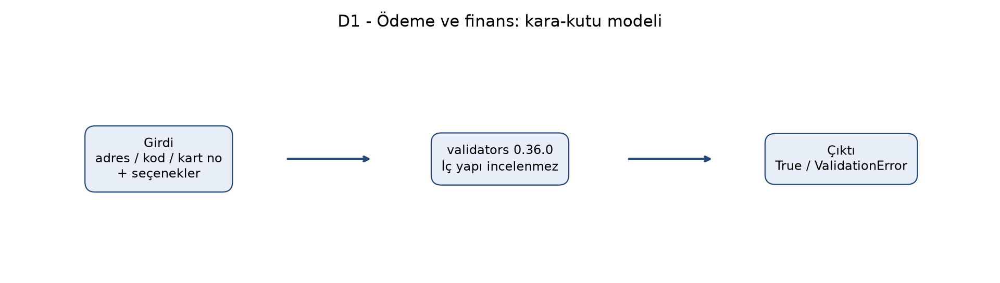
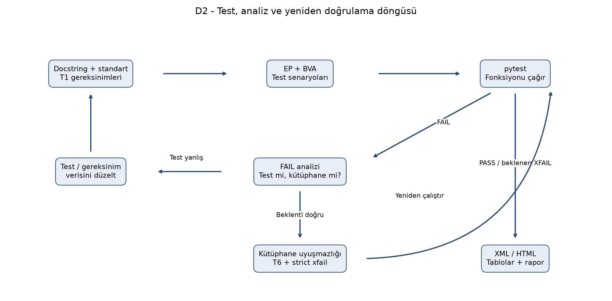
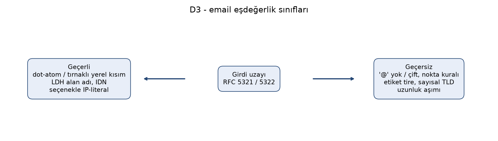
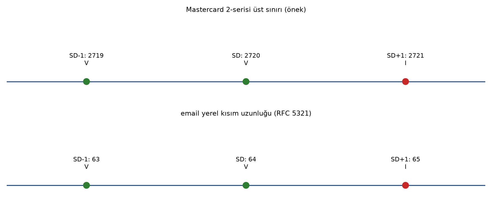
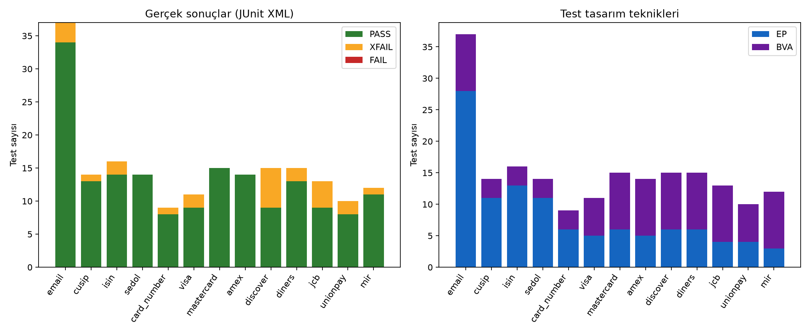

# Kara-Kutu Birim Testi - Ödeme ve Finans

Alan sahibi: **KhaledZer** (alan 3). Bu bölümün testleri, tabloları ve raporu ekip adına
**kusayvarde** tarafından hazırlanmıştır. Dal: `kusayvarde-tamamlama`. Doğrulama tarihi: **27 Kasım 2026**.
Bu bölüm ortak rapora eklenmek üzere yazılmıştır. Sonuç tabloları pytest JUnit XML çıktısından
yenilenir; diğer ekip üyelerinin test dosyaları değiştirilmemiştir.

## 1. Kapsam

Bu çalışmada `email`, `cusip`, `isin`, `sedol`, `card_number`, `visa`, `mastercard`, `amex`,
`discover`, `diners`, `jcb`, `unionpay` ve `mir` incelenmiştir. `email` çok zor (5), üç menkul
kıymet kimliği zor (3 × 3), dokuz kart doğrulayıcısı orta (9 × 2) olup toplam 32 puandır.

Ortam: Python **3.14.0**, `validators[crypto-eth-addresses]==0.36.0`, pytest **9.2.0**.
Bağımlılıklar mevcut `uv.lock` ile kurulmuştur; proje bağımlılıkları değiştirilmemiştir.
Testler yalnızca biçim, seçenek, önek ve kontrol basamağı doğrulamasını sınar. Bir e-posta
adresinin teslim edilebilir olduğunu, bir kartın gerçekten çıkarılmış veya bir menkul kıymetin
kayıtlı olduğunu kanıtlamaz.

## 2. Yöntem

**Beklentilerin tasarımında validators kaynak kodu kullanılmamıştır.** İzin verilen
`inspect.signature()` ve `.__doc__` üzerinden kurallar çıkarılmış; aşağıdaki standartlarla
tamamlanmıştır. Başarısız testler yalnızca fonksiyon çağrıları (keşif çağrıları) ve bağımsız
kontrol hesaplarıyla incelenmiştir. Kök neden yorumları iç uygulama hakkında kanıt değildir.

Docstring'ler bu alanda çok kısadır: `email` yalnızca RFC 1034/5321/5322'ye atıf yapar, menkul
kıymet doğrulayıcıları Wikipedia bağlantısı verir, kart doğrulayıcıları yalnızca bir geçerli ve bir
geçersiz örnek içerir. Bu nedenle kuralların çoğu standarttan gelir; standarda dayanan ama
docstring'in açıkça taahhüt etmediği beklentiler T6'da **gereksinim belirsizliği** olarak işaretlenir.

- **EP:** Geçerli biçimler, her biri tek kuralı bozan geçersiz biçimler ve seçenekler ayrı sınıflardır.
- **BVA:** Uzunluklar (yerel kısım, DNS etiketi, adres, PAN, sabit uzunluklu kimlikler) ve IIN önek
  aralıkları için SD-1/SD/SD+1 üçlüleri kullanılır. İki taraflı aralıklarda altı test vardır.
- **Geçersiz sınıfları ayırma:** Önek veya uzunluk testlerinde Luhn kontrol basamağı her veri için
  yeniden hesaplanır; Luhn testinde ise yalnızca son basamak değiştirilir. Böylece bir kural ihlali
  diğerini maskeleyemez. ISIN ülke kodu ve SEDOL sesli harf testlerinde kontrol basamağı doğrudur.
- **Örnekler:** On üç işlevin docstring'lerindeki tüm örnekler ayrı testtir (`Doküman örneği`).
- **Karar tablosu:** Bu bölüm EP ve BVA'ya odaklanır; DT bonusu eklenmemiştir.





### Kaynaklar ve gereksinim önceliği

İlk sözleşme kurulu **0.36.0** sürümünün docstring'idir. Standarttan eklenen beklentiler ayrıca
belirtilir; gözlenen davranışa göre beklenti üretilmez.

- E-posta sözdizimi: [RFC 5322 §3.2.3, §3.4.1](https://www.rfc-editor.org/rfc/rfc5322)
  (dot-atom, quoted-string). Uzunluk ve adres-literali:
  [RFC 5321 §4.1.3, §4.5.3.1](https://www.rfc-editor.org/rfc/rfc5321) (yerel kısım 64, yol 256).
  Adres toplamı 254: [RFC 3696 errata 1690](https://www.rfc-editor.org/errata/eid1690).
  DNS etiketi 63: [RFC 1035 §2.3.4](https://www.rfc-editor.org/rfc/rfc1035).
- CUSIP: docstring bağlantısı [Wikipedia - CUSIP](https://en.wikipedia.org/wiki/CUSIP)
  (ANSI X9.6; 8 karakter + "çift konumu ikiye katla" mod-10 kontrolü; `*`, `@`, `#` yerleşim karakterleri).
- ISIN: docstring bağlantısı [Wikipedia - ISIN](https://en.wikipedia.org/wiki/International_Securities_Identification_Number)
  (ISO 6166; ISO 3166-1 alpha-2 ülke kodu veya `XS`, 9 karakter NSIN, harfler sayıya çevrilip Luhn).
- SEDOL: docstring bağlantısı [Wikipedia - SEDOL](https://en.wikipedia.org/wiki/SEDOL)
  (London Stock Exchange; sesli harf yok, ağırlıklar 1-3-1-7-3-9).
- Kart numaraları: Luhn ve PAN uzunluğu en çok 19 basamak için ISO/IEC 7812-1;
  ağ önekleri ve uzunlukları için [Wikipedia - Payment card number](https://en.wikipedia.org/wiki/Payment_card_number)
  IIN tablosu. Bu tablo ikincil kaynaktır; kart ağlarının kendi IIN belgeleri kamuya kapalıdır.

`uretici/payments_finance.py` bu hesapları uygular ve `validators` içe aktarmaz. `ornekleri_dogrula()` üreticileri
docstring örnekleri ve kamuya açık bilinen kimliklerle (Apple CUSIP `037833100`, ISIN
`US0378331005`, BAE Systems SEDOL `0263494`) çapraz denetler.

## 3. Gereksinimler (T1)

Asıl dosya: `docs/tablolar/payments_finance/T1_gereksinimler.csv` (UTF-8 BOM, `;`). Her satır tek kuraldır.
Beklenen çıktı sütunu o satırdaki örnek girdiye aittir. Son sütun aynı kuralın hem geçerli hem
geçersiz örneklerini kapsayabilir. Kısaltmalar işlev önekiyle açılır; örneğin `REQ-CUSIP`
satırındaki `EP-01`, `TC-CUSIP-EP-01` anlamındadır.

<!-- OTOMATIK:T1 -->
| ID | Fonksiyon | Gereksinim | Örnek girdi | Beklenen çıktı | Kaynak | Sınayan testler |
| --- | --- | --- | --- | --- | --- | --- |
| REQ-EMAIL-01 | email | Adres tek '@' ile ayrılmış boş olmayan yerel kısım ve alan adından oluşur | someone@example.com | True | validators==0.36.0 email.__doc__; RFC 5322 https://www.rfc-editor.org/rfc/rfc5322 | EP-01, EP-02, EP-14..17, EP-28 |
| REQ-EMAIL-02 | email | Yerel kısım RFC 5322 dot-atom (atext, ardışık olmayan noktalar) veya tırnaklı dizedir | "ali veli"@example.com | True | RFC 5322 https://www.rfc-editor.org/rfc/rfc5322 §3.2.3, §3.4.1 | EP-03..07, EP-18..21 |
| REQ-EMAIL-03 | email | Alan adı LDH etiketlerinden oluşur, TLD zorunludur ve tamamen sayısal olamaz; punycode IDN geçerlidir | user@-example.com | ValidationError | RFC 1034/1035; RFC 3696 §2 | EP-08, EP-22, EP-23, EP-27 |
| REQ-EMAIL-04 | email | ipv4_address/ipv6_address=True iken RFC 5321 adres-literali kabul edilir; varsayılanda reddedilir | user@[192.168.0.1] | True | validators==0.36.0 email.__doc__; RFC 5321 https://www.rfc-editor.org/rfc/rfc5321 §4.1.3 | EP-09, EP-10, EP-26 |
| REQ-EMAIL-05 | email | simple_host=True tek etiketli ana makineye izin verir; varsayılanda reddedilir | user@localhost | True | validators==0.36.0 email.__doc__ | EP-11, EP-23 |
| REQ-EMAIL-06 | email | rfc_1034=True sondaki noktaya izin verir; varsayılanda reddedilir | user@example.com. | True | validators==0.36.0 email.__doc__; RFC 1034 | EP-12, EP-24 |
| REQ-EMAIL-07 | email | rfc_2782=True SRV adı alt çizgisine izin verir; varsayılanda reddedilir | user@_sip._tcp.example.com | True | validators==0.36.0 email.__doc__; RFC 2782 | EP-13, EP-25 |
| REQ-EMAIL-08 | email | Yerel kısım en çok 64 karakterdir | 'a'×65 + '@example.com' | ValidationError | RFC 5321 https://www.rfc-editor.org/rfc/rfc5321 §4.5.3.1.1 | BVA-01..03 |
| REQ-EMAIL-09 | email | Alan adı etiketi en çok 63 karakterdir | user@'a'×64.com | ValidationError | RFC 1035 §2.3.4 https://www.rfc-editor.org/rfc/rfc1035 | BVA-04..06 |
| REQ-EMAIL-10 | email | Adres toplam en çok 254 karakterdir | 255 karakterlik adres | ValidationError | RFC 5321 https://www.rfc-editor.org/rfc/rfc5321 §4.5.3.1.3; RFC 3696 errata 1690 | BVA-07..09 |
| REQ-CUSIP-01 | cusip | 9. karakter ilk 8 karakterin mod-10 kontrol basamağıdır | 037833DP2 | True | validators==0.36.0 cusip.__doc__; CUSIP Global Services / ANSI X9.6; https://en.wikipedia.org/wiki/CUSIP | EP-01..04, EP-06, EP-07 |
| REQ-CUSIP-02 | cusip | Karakterler rakam, büyük harf ve yerleşim karakterleri * @ # olabilir | 037833dp2 | ValidationError | CUSIP Global Services / ANSI X9.6; https://en.wikipedia.org/wiki/CUSIP | EP-05, EP-08..10 |
| REQ-CUSIP-03 | cusip | Boş CUSIP geçersizdir | '' | ValidationError | validators==0.36.0 cusip.__doc__ | EP-11 |
| REQ-CUSIP-04 | cusip | CUSIP tam 9 karakterdir | 037833DP | ValidationError | CUSIP Global Services / ANSI X9.6; https://en.wikipedia.org/wiki/CUSIP | BVA-01..03 |
| REQ-ISIN-01 | isin | 12. karakter, harfleri sayıya çevrilmiş ilk 11 karakterin Luhn kontrol basamağıdır | US0378331005 | True | validators==0.36.0 isin.__doc__; ISO 6166; https://en.wikipedia.org/wiki/International_Securities_Identification_Number | EP-03..05, EP-07, EP-11 |
| REQ-ISIN-02 | isin | İlk iki karakter ISO 3166-1 alpha-2 ülke kodu veya XS gibi ISO 6166 önekidir | ZZ0002634945 | ValidationError | ISO 6166; https://en.wikipedia.org/wiki/International_Securities_Identification_Number; ISO 3166-1 | EP-06, EP-08, EP-10 |
| REQ-ISIN-03 | isin | Karakterler büyük harf ve rakamdır | us0378331005 | ValidationError | ISO 6166; https://en.wikipedia.org/wiki/International_Securities_Identification_Number | EP-09, EP-12 |
| REQ-ISIN-04 | isin | Boş ISIN geçersizdir | '' | ValidationError | validators==0.36.0 isin.__doc__ | EP-13 |
| REQ-ISIN-05 | isin | ISIN tam 12 karakterdir | 037833DP2 | ValidationError | validators==0.36.0 isin.__doc__; ISO 6166; https://en.wikipedia.org/wiki/International_Securities_Identification_Number | EP-01, EP-02, BVA-01..03 |
| REQ-SEDOL-01 | sedol | 7. karakter 1-3-1-7-3-9 ağırlıklı mod-10 kontrol basamağıdır | 2936921 | True | validators==0.36.0 sedol.__doc__; London Stock Exchange SEDOL; https://en.wikipedia.org/wiki/SEDOL | EP-01, EP-03..06, EP-09 |
| REQ-SEDOL-02 | sedol | SEDOL sesli harf (A E I O U) içermez | 29A6922 | ValidationError | validators==0.36.0 sedol.__doc__; London Stock Exchange SEDOL; https://en.wikipedia.org/wiki/SEDOL | EP-02, EP-07 |
| REQ-SEDOL-03 | sedol | Karakterler rakam ve büyük ünsüz harftir | b0ybkj7 | ValidationError | London Stock Exchange SEDOL; https://en.wikipedia.org/wiki/SEDOL | EP-08, EP-10 |
| REQ-SEDOL-04 | sedol | Boş SEDOL geçersizdir | '' | ValidationError | validators==0.36.0 sedol.__doc__ | EP-11 |
| REQ-SEDOL-05 | sedol | SEDOL tam 7 karakterdir | 026349 | ValidationError | London Stock Exchange SEDOL; https://en.wikipedia.org/wiki/SEDOL | BVA-01..03 |
| REQ-CARD_NUMBER-01 | card_number | Genel kart numarası Luhn kontrolünü sağlar (ağdan bağımsız) | 4242424242424242 | True | validators==0.36.0 card_number.__doc__; ISO/IEC 7812-1 Ek B (Luhn) | EP-01..04 |
| REQ-CARD_NUMBER-02 | card_number | Kart numarası yalnızca rakamdan oluşur ve boş olamaz | 4242a42424242424 | ValidationError | ISO/IEC 7812-1 Ek B (Luhn) | EP-05, EP-06 |
| REQ-CARD_NUMBER-03 | card_number | PAN en çok 19 basamaktır | 20 basamak | ValidationError | ISO/IEC 7812-1 | BVA-01..03 |
| REQ-VISA-01 | visa | Visa numarası 4 ile başlar ve Luhn kontrolünü sağlar | 4242424242424242 | True | validators==0.36.0 visa.__doc__; Kart ağı IIN aralıkları: https://en.wikipedia.org/wiki/Payment_card_number | EP-01, EP-02, EP-05, BVA-01..03 |
| REQ-VISA-02 | visa | Visa numarası 13, 16 veya 19 basamaktır | 4000000000006 | True | Kart ağı IIN aralıkları: https://en.wikipedia.org/wiki/Payment_card_number | EP-03, EP-04, BVA-04..06 |
| REQ-MASTERCARD-01 | mastercard | Mastercard numarası Luhn kontrolünü sağlar | 5555555555554444 | True | validators==0.36.0 mastercard.__doc__; ISO/IEC 7812-1 Ek B (Luhn) | EP-01, EP-05 |
| REQ-MASTERCARD-02 | mastercard | Önek 51-55 veya 2221-2720 aralığındadır | 2221000000000009 | True | validators==0.36.0 mastercard.__doc__; Kart ağı IIN aralıkları: https://en.wikipedia.org/wiki/Payment_card_number | EP-02..04, EP-06, BVA-01..06 |
| REQ-MASTERCARD-03 | mastercard | Mastercard numarası 16 basamaktır | 15 basamak | ValidationError | Kart ağı IIN aralıkları: https://en.wikipedia.org/wiki/Payment_card_number | BVA-07..09 |
| REQ-AMEX-01 | amex | Amex numarası Luhn kontrolünü sağlar | 378282246310005 | True | validators==0.36.0 amex.__doc__; ISO/IEC 7812-1 Ek B (Luhn) | EP-01, EP-05 |
| REQ-AMEX-02 | amex | Önek 34 veya 37'dir | 350000000000006 | ValidationError | validators==0.36.0 amex.__doc__; Kart ağı IIN aralıkları: https://en.wikipedia.org/wiki/Payment_card_number | EP-02..04, BVA-01..06 |
| REQ-AMEX-03 | amex | Amex numarası 15 basamaktır | 16 basamak | ValidationError | Kart ağı IIN aralıkları: https://en.wikipedia.org/wiki/Payment_card_number | BVA-07..09 |
| REQ-DISCOVER-01 | discover | Discover numarası Luhn kontrolünü sağlar | 6011111111111117 | True | validators==0.36.0 discover.__doc__; ISO/IEC 7812-1 Ek B (Luhn) | EP-01, EP-05 |
| REQ-DISCOVER-02 | discover | Önek 6011, 622126-622925, 644-649 veya 65'tir | 6012000000000003 | ValidationError | validators==0.36.0 discover.__doc__; Kart ağı IIN aralıkları: https://en.wikipedia.org/wiki/Payment_card_number | EP-02..04, EP-06, BVA-01..03 |
| REQ-DISCOVER-03 | discover | Discover numarası 16-19 basamaktır | 17 basamak | True | Kart ağı IIN aralıkları: https://en.wikipedia.org/wiki/Payment_card_number | BVA-04..09 |
| REQ-DINERS-01 | diners | Diners numarası Luhn kontrolünü sağlar | 3056930009020004 | True | validators==0.36.0 diners.__doc__; ISO/IEC 7812-1 Ek B (Luhn) | EP-01, EP-05 |
| REQ-DINERS-02 | diners | Önek 300-305, 36 veya 38-39'dur | 30600000000001 | ValidationError | validators==0.36.0 diners.__doc__; Kart ağı IIN aralıkları: https://en.wikipedia.org/wiki/Payment_card_number | EP-02..04, EP-06, BVA-01..06 |
| REQ-DINERS-03 | diners | Diners numarası 14-19 basamaktır | 13 basamak | ValidationError | Kart ağı IIN aralıkları: https://en.wikipedia.org/wiki/Payment_card_number | BVA-07..09 |
| REQ-JCB-01 | jcb | JCB numarası Luhn kontrolünü sağlar | 3566002020360505 | True | validators==0.36.0 jcb.__doc__; ISO/IEC 7812-1 Ek B (Luhn) | EP-01, EP-04 |
| REQ-JCB-02 | jcb | Önek 3528-3589 aralığındadır | 3590000000000000 | ValidationError | validators==0.36.0 jcb.__doc__; Kart ağı IIN aralıkları: https://en.wikipedia.org/wiki/Payment_card_number | EP-02, BVA-01..06 |
| REQ-JCB-03 | jcb | JCB numarası 16-19 basamaktır | 19 basamak | True | Kart ağı IIN aralıkları: https://en.wikipedia.org/wiki/Payment_card_number | EP-03, BVA-07..09 |
| REQ-UNIONPAY-01 | unionpay | UnionPay numarası Luhn kontrolünü sağlar | 6200000000000005 | True | validators==0.36.0 unionpay.__doc__; ISO/IEC 7812-1 Ek B (Luhn) | EP-01, EP-04 |
| REQ-UNIONPAY-02 | unionpay | Önek 62'dir | 6300000000000004 | ValidationError | validators==0.36.0 unionpay.__doc__; Kart ağı IIN aralıkları: https://en.wikipedia.org/wiki/Payment_card_number | EP-02, BVA-01..03 |
| REQ-UNIONPAY-03 | unionpay | UnionPay numarası 16-19 basamaktır | 19 basamak | True | Kart ağı IIN aralıkları: https://en.wikipedia.org/wiki/Payment_card_number | EP-03, BVA-04..06 |
| REQ-MIR-01 | mir | Mir numarası Luhn kontrolünü sağlar | 2200123456789019 | True | validators==0.36.0 mir.__doc__; ISO/IEC 7812-1 Ek B (Luhn) | EP-01, EP-03 |
| REQ-MIR-02 | mir | Önek 2200-2204 aralığındadır | 2205000000000009 | ValidationError | validators==0.36.0 mir.__doc__; Kart ağı IIN aralıkları: https://en.wikipedia.org/wiki/Payment_card_number; NSPK | EP-02, BVA-01..06 |
| REQ-MIR-03 | mir | Mir numarası 16-19 basamaktır | 15 basamak | ValidationError | Kart ağı IIN aralıkları: https://en.wikipedia.org/wiki/Payment_card_number | BVA-07..09 |
<!-- /OTOMATIK:T1 -->

## 4. Eşdeğerlik sınıfları (T2)

Tam T2, `reports/tablolar.xlsx` içindeki **T2 Eşdeğerlik Sınıfları** sayfasında işlev adına göre
filtrelenebilir. Sınıflar kod içindeki `tc` işaretlerinden otomatik üretilir.

Aşağıdaki temsilciler de aynı pytest XML verisinden alınır; her işlev için bir geçerli ve bir
geçersiz EP örneği gösterilir.

<!-- OTOMATIK:T2 -->
| Fonksiyon | Sınıf | Temsilci girdi | Beklenen | Test ID |
| --- | --- | --- | --- | --- |
| email | Doküman örneği (geçerli) | 'someone@example.com' | True | TC-EMAIL-EP-01 |
| email | Doküman örneği (geçersiz) | 'bogus@@' | ValidationError | TC-EMAIL-EP-02 |
| cusip | Doküman örneği (geçerli) | '037833DP2' | True | TC-CUSIP-EP-01 |
| cusip | Doküman örneği (geçersiz) | '037833DP3' | ValidationError | TC-CUSIP-EP-02 |
| isin | V1 ABD ISIN (Apple) | 'US0378331005' | True | TC-ISIN-EP-03 |
| isin | Doküman örneği (geçersiz) | '037833DP2' | ValidationError | TC-ISIN-EP-01 |
| sedol | Doküman örneği (geçerli) | '2936921' | True | TC-SEDOL-EP-01 |
| sedol | Doküman örneği (geçersiz) | '29A6922' | ValidationError | TC-SEDOL-EP-02 |
| card_number | Doküman örneği (geçerli) | '4242424242424242' | True | TC-CARD_NUMBER-EP-01 |
| card_number | Doküman örneği (geçersiz) | '4242424242424241' | ValidationError | TC-CARD_NUMBER-EP-02 |
| visa | Doküman örneği (geçerli) | '4242424242424242' | True | TC-VISA-EP-01 |
| visa | Doküman örneği (geçersiz) | '2223003122003222' | ValidationError | TC-VISA-EP-02 |
| mastercard | Doküman örneği (geçerli) | '5555555555554444' | True | TC-MASTERCARD-EP-01 |
| mastercard | Doküman örneği (geçersiz) | '4242424242424242' | ValidationError | TC-MASTERCARD-EP-02 |
| amex | Doküman örneği (geçerli) | '378282246310005' | True | TC-AMEX-EP-01 |
| amex | Doküman örneği (geçersiz) | '4242424242424242' | ValidationError | TC-AMEX-EP-02 |
| discover | Doküman örneği (geçerli) | '6011111111111117' | True | TC-DISCOVER-EP-01 |
| discover | Doküman örneği (geçersiz) | '4242424242424242' | ValidationError | TC-DISCOVER-EP-02 |
| diners | Doküman örneği (geçerli) | '3056930009020004' | True | TC-DINERS-EP-01 |
| diners | Doküman örneği (geçersiz) | '4242424242424242' | ValidationError | TC-DINERS-EP-02 |
| jcb | Doküman örneği (geçerli) | '3566002020360505' | True | TC-JCB-EP-01 |
| jcb | Doküman örneği (geçersiz) | '4242424242424242' | ValidationError | TC-JCB-EP-02 |
| unionpay | Doküman örneği (geçerli) | '6200000000000005' | True | TC-UNIONPAY-EP-01 |
| unionpay | Doküman örneği (geçersiz) | '4242424242424242' | ValidationError | TC-UNIONPAY-EP-02 |
| mir | Doküman örneği (geçerli) | '2200123456789019' | True | TC-MIR-EP-01 |
| mir | Doküman örneği (geçersiz) | '4242424242424242' | ValidationError | TC-MIR-EP-02 |
<!-- /OTOMATIK:T2 -->

| İşlev | Geçerli sınıf | Geçersiz sınıf |
| --- | --- | --- |
| email | dot-atom / tırnaklı yerel kısım, LDH/IDN alan adı, seçenekle literal | '@' yok/çift, nokta kuralı, sayısal TLD |
| cusip | 8 alfasayısal + doğru mod-10 kontrolü | Yanlış kontrol, küçük harf, özel karakter |
| isin | Ülke kodu + NSIN + Luhn kontrolü | Rakam/atanmamış ülke kodu, yanlış kontrol |
| sedol | 6 ünsüz/rakam + ağırlıklı kontrol | Sesli harf, yanlış kontrol, küçük harf |
| card_number | Luhn doğru rakam dizisi | Luhn yanlış, harf, boş |
| visa … mir | Ağ öneki + ağ uzunluğu + Luhn | Başka ağ öneki, yanlış uzunluk, Luhn hatası |



Kart verileri `kart_uret(onek, uzunluk)` ile üretilir: önek sıfırlarla doldurulur ve son basamak
Luhn ile tamamlanır. Böylece aynı önek farklı uzunluklarda, aynı uzunluk farklı öneklerde tek
değişkenle sınanır. Üretilen numaralar gerçek kart değildir.

## 5. Sınır değer analizi (T3)

Sabit uzunluklu kimliklerde (CUSIP 9, ISIN 12, SEDOL 7) N-1/N/N+1 değerleri biçim sınırını sınar.
Kart ağlarında iki tür sınır vardır: **önek aralığı** (ör. Mastercard 2221-2720, JCB 3528-3589,
Mir 2200-2204, Diners 300-305) ve **uzunluk** (ör. Amex 15, Discover 16-19). Önek sınırlarında
uzunluk ve Luhn doğru tutulur. Tek değerli öneklerde (Visa 4, UnionPay 62, Amex 34/37) komşu
önekler SD-1/SD+1 olarak kullanılır. E-postada yerel kısım (64), DNS etiketi (63) ve adres toplamı
(254) ayrı gruplardır; toplam uzunluk testlerinde yerel kısım 64'te sabit, her etiket 63 altındadır.



<!-- OTOMATIK:T3 -->
| Fonksiyon | Sınır | SD-1 | SD | SD+1 | Beklenen | Test ID |
| --- | --- | --- | --- | --- | --- | --- |
| email | Yerel kısım uzunluğu | 'aaaaaaaaaaaa…' (75 karakter)  → sınır değeri (63) | 'aaaaaaaaaaaa…' (76 karakter)  → sınır değeri (64) | 'aaaaaaaaaaaa…' (77 karakter)  → sınır değeri (65) | V / V / I | TC-EMAIL-BVA-01, TC-EMAIL-BVA-02, TC-EMAIL-BVA-03 |
| email | Alan adı etiketi | 'user@aaaaaaa…' (71 karakter)  → sınır değeri (62) | 'user@aaaaaaa…' (72 karakter)  → sınır değeri (63) | 'user@aaaaaaa…' (73 karakter)  → sınır değeri (64) | V / V / I | TC-EMAIL-BVA-04, TC-EMAIL-BVA-05, TC-EMAIL-BVA-06 |
| email | Adres toplam uzunluğu | 'aaaaaaaaaaaa…' (253 karakter)  → sınır değeri (253) | 'aaaaaaaaaaaa…' (254 karakter)  → sınır değeri (254) | 'aaaaaaaaaaaa…' (255 karakter)  → sınır değeri (255) | V / V / I | TC-EMAIL-BVA-07, TC-EMAIL-BVA-08, TC-EMAIL-BVA-09 |
| card_number | PAN üst uzunluk | '400000000000000002' | '4000000000000000006' | '40000000000000000002' | V / V / I | TC-CARD_NUMBER-BVA-01, TC-CARD_NUMBER-BVA-02, TC-CARD_NUMBER-BVA-03 |
| visa | Önek | '3000000000000004' | '4000000000000002' | '5000000000000009' | I / V / I | TC-VISA-BVA-01, TC-VISA-BVA-02, TC-VISA-BVA-03 |
| visa | Uzunluk 16 | '400000000000006' | '4000000000000002' | '40000000000000006' | I / V / I | TC-VISA-BVA-04, TC-VISA-BVA-05, TC-VISA-BVA-06 |
| mastercard | 2-serisi alt | '2220000000000000' | '2221000000000009' | '2222000000000008' | I / V / V | TC-MASTERCARD-BVA-01, TC-MASTERCARD-BVA-02, TC-MASTERCARD-BVA-03 |
| mastercard | 2-serisi üst | '2719000000000008' | '2720000000000005' | '2721000000000004' | V / V / I | TC-MASTERCARD-BVA-04, TC-MASTERCARD-BVA-05, TC-MASTERCARD-BVA-06 |
| mastercard | Uzunluk 16 | '510000000000003' | '5100000000000008' | '51000000000000003' | I / V / I | TC-MASTERCARD-BVA-07, TC-MASTERCARD-BVA-08, TC-MASTERCARD-BVA-09 |
| amex | Önek 34 | '330000000000001' | '340000000000009' | '350000000000006' | I / V / I | TC-AMEX-BVA-01, TC-AMEX-BVA-02, TC-AMEX-BVA-03 |
| amex | Önek 37 | '360000000000004' | '370000000000002' | '380000000000000' | I / V / I | TC-AMEX-BVA-04, TC-AMEX-BVA-05, TC-AMEX-BVA-06 |
| amex | Uzunluk 15 | '37000000000007' | '370000000000002' | '3700000000000007' | I / V / I | TC-AMEX-BVA-07, TC-AMEX-BVA-08, TC-AMEX-BVA-09 |
| discover | 644-649 alt | '6430000000000007' | '6440000000000005' | '6450000000000002' | I / V / V | TC-DISCOVER-BVA-01, TC-DISCOVER-BVA-02, TC-DISCOVER-BVA-03 |
| discover | Uzunluk alt | '601100000000001' | '6011000000000004' | '60110000000000001' | I / V / V | TC-DISCOVER-BVA-04, TC-DISCOVER-BVA-05, TC-DISCOVER-BVA-06 |
| discover | Uzunluk üst | '601100000000000004' | '6011000000000000001' | '60110000000000000004' | V / V / I | TC-DISCOVER-BVA-07, TC-DISCOVER-BVA-08, TC-DISCOVER-BVA-09 |
| diners | 300-305 alt | '29900000000008' | '30000000000004' | '30100000000002' | I / V / V | TC-DINERS-BVA-01, TC-DINERS-BVA-02, TC-DINERS-BVA-03 |
| diners | 300-305 üst | '30400000000006' | '30500000000003' | '30600000000001' | V / V / I | TC-DINERS-BVA-04, TC-DINERS-BVA-05, TC-DINERS-BVA-06 |
| diners | Uzunluk alt | '3600000000004' | '36000000000008' | '360000000000004' | I / V / V | TC-DINERS-BVA-07, TC-DINERS-BVA-08, TC-DINERS-BVA-09 |
| jcb | 3528-3589 alt | '3527000000000008' | '3528000000000007' | '3529000000000006' | I / V / V | TC-JCB-BVA-01, TC-JCB-BVA-02, TC-JCB-BVA-03 |
| jcb | 3528-3589 üst | '3588000000000004' | '3589000000000003' | '3590000000000000' | V / V / I | TC-JCB-BVA-04, TC-JCB-BVA-05, TC-JCB-BVA-06 |
| jcb | Uzunluk alt | '353000000000003' | '3530000000000003' | '35300000000000003' | I / V / V | TC-JCB-BVA-07, TC-JCB-BVA-08, TC-JCB-BVA-09 |
| unionpay | Önek | '6100000000000006' | '6200000000000005' | '6300000000000004' | I / V / I | TC-UNIONPAY-BVA-01, TC-UNIONPAY-BVA-02, TC-UNIONPAY-BVA-03 |
| unionpay | Uzunluk alt | '620000000000000' | '6200000000000005' | '62000000000000000' | I / V / V | TC-UNIONPAY-BVA-04, TC-UNIONPAY-BVA-05, TC-UNIONPAY-BVA-06 |
| mir | 2200-2204 alt | '2199000000000007' | '2200000000000004' | '2201000000000003' | I / V / V | TC-MIR-BVA-01, TC-MIR-BVA-02, TC-MIR-BVA-03 |
| mir | 2200-2204 üst | '2203000000000001' | '2204000000000000' | '2205000000000009' | V / V / I | TC-MIR-BVA-04, TC-MIR-BVA-05, TC-MIR-BVA-06 |
| mir | Uzunluk alt | '220000000000004' | '2200000000000004' | '22000000000000004' | I / V / V | TC-MIR-BVA-07, TC-MIR-BVA-08, TC-MIR-BVA-09 |
| cusip | Biçim uzunluğu | '037833DP' | '037833DP2' | '037833DP20' | I / V / I | TC-CUSIP-BVA-01, TC-CUSIP-BVA-02, TC-CUSIP-BVA-03 |
| isin | Biçim uzunluğu | 'US037833100' | 'US0378331005' | 'US03783310050' | I / V / I | TC-ISIN-BVA-01, TC-ISIN-BVA-02, TC-ISIN-BVA-03 |
| sedol | Biçim uzunluğu | '026349' | '0263494' | '02634940' | I / V / I | TC-SEDOL-BVA-01, TC-SEDOL-BVA-02, TC-SEDOL-BVA-03 |
<!-- /OTOMATIK:T3 -->

## 6. Test senaryoları (T4)

Tam liste `reports/tablolar.xlsx` içindeki **T4a Test Senaryoları** ve **T4b Test Sonuçları**
sayfalarındadır; işlev sütunundan bu bölümün on üç işlevi seçilir. T4a'da gerçek sonuç/durum boş
bırakılır; T4b yalnızca pytest XML çıktısından doldurulur. Bu çıktılar yeniden üretilebilir olduğu
için Git'e eklenmez. Koddaki her senaryonun kimliği T1 ile eşleşir.

Her işlevden bir BVA kaydının gerçekleşen sonucu aşağıda pytest XML'den gösterilir:

<!-- OTOMATIK:T4 -->
| Test ID | Girdi | Parametreler | Beklenen | Gerçekleşen | Durum |
| --- | --- | --- | --- | --- | --- |
| TC-EMAIL-BVA-01 | 'aaaaaaaaaaaaaaaaaaaaaaaaaaaaaaaaaaaaaaaaaaaaaaaaaaaaaaaaaaa… (75 karakter) | — | True | True | PASS |
| TC-CUSIP-BVA-01 | '037833DP' | — | ValidationError | ValidationError | PASS |
| TC-ISIN-BVA-01 | 'US037833100' | — | ValidationError | ValidationError | PASS |
| TC-SEDOL-BVA-01 | '026349' | — | ValidationError | ValidationError | PASS |
| TC-CARD_NUMBER-BVA-01 | '400000000000000002' | — | True | True | PASS |
| TC-VISA-BVA-01 | '3000000000000004' | — | ValidationError | ValidationError | PASS |
| TC-MASTERCARD-BVA-01 | '2220000000000000' | — | ValidationError | ValidationError | PASS |
| TC-AMEX-BVA-01 | '330000000000001' | — | ValidationError | ValidationError | PASS |
| TC-DISCOVER-BVA-01 | '6430000000000007' | — | ValidationError | True | XFAIL |
| TC-DINERS-BVA-01 | '29900000000008' | — | ValidationError | ValidationError | PASS |
| TC-JCB-BVA-01 | '3527000000000008' | — | ValidationError | True | XFAIL |
| TC-UNIONPAY-BVA-01 | '6100000000000006' | — | ValidationError | ValidationError | PASS |
| TC-MIR-BVA-01 | '2199000000000007' | — | ValidationError | ValidationError | PASS |
<!-- /OTOMATIK:T4 -->

Örnek: `TC-ISIN-EP-10` ülke kodu `ZZ` olan ama Luhn kontrol basamağı doğru hesaplanmış ISIN'i
reddetmeyi bekler; tek bozulan kural ülke kodudur. `TC-MASTERCARD-BVA-06` 2-serisinin hemen
üstündeki `2721` önekini, uzunluk ve Luhn doğru iken sınar.

## 7. Otomasyon

`tests/payments_finance/` altındaki `test_email.py`, `test_menkul_kiymet.py` (cusip/isin/sedol) ve `test_kartlar.py` (dokuz kart
işlevi) dosyaları ortak `tc` ve `dogrula` yapısını kullanır:

```python
@pytest.mark.parametrize("girdi, parametreler, beklenen", EP + BVA)
def test_email(dogrula, girdi, parametreler, beklenen):
    dogrula("email", girdi, parametreler, beklenen)
```

`dogrula` geçerli sonuçta `sonuc is True`, geçersiz sonuçta hem falsy değer hem `ValidationError`
tipini denetler. `pytest.raises` kullanılmaz. Doğru beklentiyle çelişen bulgular
`bug="BUG-4x: ..."` biçiminde **strict xfail** olarak korunur; beklenmedik bir düzelme XPASS
nedeniyle test çalışmasını başarısız yapar.

PowerShell ile depo kökünden yeniden üretim:

```powershell
$env:PYTHONIOENCODING = 'utf-8'
uv sync --locked
uv run python -m uretici.payments_finance
uv run pytest
uv run python scripts/sonuc_tablosu.py
uv run python scripts/rapor_uret.py payments_finance
```

Son komut yalnızca bu bölümün raporundaki otomatik blokları, T6'nın gözlenen değerlerini ve kendi
D1-D5 görsellerini yeniler. Ortak T1 kontrolü tüm alanların sonucunu beklediği için tam pytest gerekir.

## 8. Sonuçlar (T5)

Aşağıdaki sayılar mevcut JUnit XML dosyasından hesaplanmıştır. XFAIL, işlevin doğru çalıştığı
anlamına gelmez; belgelenmiş bir uyuşmazlığın yeniden gözlendiğini gösterir.

<!-- OTOMATIK:T5 -->
| Fonksiyon | Toplam | EP | BVA | PASS | FAIL | XFAIL |
| --- | --- | --- | --- | --- | --- | --- |
| email | 37 | 28 | 9 | 34 | 0 | 3 |
| cusip | 14 | 11 | 3 | 13 | 0 | 1 |
| isin | 16 | 13 | 3 | 14 | 0 | 2 |
| sedol | 14 | 11 | 3 | 14 | 0 | 0 |
| card_number | 9 | 6 | 3 | 8 | 0 | 1 |
| visa | 11 | 5 | 6 | 9 | 0 | 2 |
| mastercard | 15 | 6 | 9 | 15 | 0 | 0 |
| amex | 14 | 5 | 9 | 14 | 0 | 0 |
| discover | 15 | 6 | 9 | 9 | 0 | 6 |
| diners | 15 | 6 | 9 | 13 | 0 | 2 |
| jcb | 13 | 4 | 9 | 9 | 0 | 4 |
| unionpay | 10 | 4 | 6 | 8 | 0 | 2 |
| mir | 12 | 3 | 9 | 11 | 0 | 1 |
| TOPLAM | 195 | 108 | 87 | 171 | 0 | 24 |

Alan: 195 test, 171 PASS, 0 FAIL, 24 XFAIL. Tüm depo: 995 test, 940 PASS, 0 FAIL, 55 XFAIL.

T1: 50 gereksinim; T3: 29 sınır grubu. Başarı oranı: %87.7 (XFAIL başarıya eklenmemiştir).
<!-- /OTOMATIK:T5 -->



İncelenebilir yürütme kanıtları: `reports/sonuc.xml` ve `reports/rapor.html`. Sonuçlar
çalıştırma tarihindeki kilitli sürümlere aittir; başka sürümler için genellenemez.

## 9. Bulgular ve analiz (T6)

<!-- OTOMATIK:T6 -->
| Bulgu ID | Test ID | Girdi | Beklenen | Gerçekleşen | Kök neden yorumu | Önem |
| --- | --- | --- | --- | --- | --- | --- |
| BUG-40 | TC-EMAIL-EP-06 | '"ali veli"@example.com' | True | ValidationError | Tırnaklı yerel kısım reddediliyor. RFC 5322 §3.4.1 quoted-string yerel kısmı tanımlar ve docstring RFC 5322'ye atıf yapar. Keşif çağrısı: boşluksuz '"ali"@example.com' kabul ediliyor; dolayısıyla tırnak değil, tırnak içindeki boşluk reddediliyor. İç neden kaynak okunmadığı için bilinmiyor. | Düşük |
| BUG-41 | TC-EMAIL-EP-10 | 'user@[IPv6:2001:db8::1]' | True | ValidationError | ipv6_address=True iken RFC 5321 §4.1.3'teki 'IPv6:' etiketli adres-literali reddediliyor; keşif çağrısında etiketsiz 'user@[2001:db8::1]' kabul ediliyor. Docstring biçimi tanımlamadığı için gereksinim belirsizliği vardır. | Düşük |
| BUG-42 | TC-EMAIL-BVA-09 | 'aaaaaaaaaaaaaaaaaaaaaaaaaaaaaaaaaaaaaaaaaaaaaaaaaaaaaaaaaaa… (255 karakter) | ValidationError | True | 254 karakteri aşan adres kabul ediliyor; keşif çağrılarında 300 kabul, 320 reddediliyor. RFC 3696'nın düzeltilmeden önceki 320 sınırı (64+1+255) ile uyumlu görünüyor; RFC 5321 yol sınırı ve RFC 3696 errata 1690'a göre doğru sınır 254'tür. | Düşük |
| BUG-43 | TC-CARD_NUMBER-BVA-03 | '40000000000000000002' | ValidationError | True | Genel kart numarasında uzunluk denetlenmiyor: Luhn'u doğru 20, 25, 40 ve hatta 2 basamaklı diziler kabul ediliyor. ISO/IEC 7812-1 PAN en çok 19 basamaktır. Docstring yalnızca Luhn'dan söz ettiği için gereksinim belirsizliği vardır. | Düşük |
| BUG-44 | TC-VISA-EP-03, TC-VISA-EP-04 | '4000000000006' \| '4000000000000000006' | True | ValidationError | Yalnızca 16 haneli Visa kabul ediliyor (12-20 arası tarama). Visa 13 haneli (eski) ve 19 haneli kartlar da çıkarmaktadır; geçerli kartlar reddediliyor. | Orta |
| BUG-45 | TC-DISCOVER-BVA-06, TC-DISCOVER-BVA-07, TC-DISCOVER-BVA-08, TC-DINERS-BVA-09, TC-JCB-EP-03, TC-JCB-BVA-09, TC-UNIONPAY-EP-03, TC-UNIONPAY-BVA-06, TC-MIR-BVA-09 | '60110000000000001' \| '601100000000000004' \| '6011000000000000001' \| '360000000000004' \| '3530000000000000003' \| '35300000000000003' \| '6200000000000000000' \| '62000000000000000' \| '22000000000000004' | True | ValidationError | Kart ağlarının 16-19 (Diners 14-19) uzunluk aralığı uygulanmıyor: Discover, JCB, UnionPay ve Mir yalnızca 16, Diners yalnızca 14 ve 16 basamak kabul ediyor. 17-19 basamaklı geçerli kartlar reddediliyor. | Orta |
| BUG-46 | TC-DISCOVER-EP-06, TC-DISCOVER-BVA-01 | '6012000000000003' \| '6430000000000007' | ValidationError | True | Discover önek denetimi standarttan geniş: 6012, 600, 602, 609 ve 640-643 önekleri kabul ediliyor. Discover IIN aralıkları 6011, 622126-622925, 644-649 ve 65'tir. Başka ağa ait numara Discover sayılabilir. | Orta |
| BUG-47 | TC-DISCOVER-EP-04 | '6221260000000000' | True | ValidationError | Discover/UnionPay ortak markalı 622126-622925 aralığı discover tarafından reddediliyor (unionpay kabul ediyor). Ortak markalı aralık iki ağa ait olduğundan gereksinim belirsizliği vardır. | Düşük |
| BUG-48 | TC-DINERS-BVA-06 | '30600000000001' | ValidationError | True | Diners 300-305 aralığının dışındaki 306-309 önekleri kabul ediliyor; önek denetimi '30' düzeyinde yapılıyor gibi görünüyor. | Düşük |
| BUG-49 | TC-JCB-BVA-01, TC-JCB-BVA-06 | '3527000000000008' \| '3590000000000000' | ValidationError | True | JCB 3528-3589 aralığı dışındaki 3500, 3527, 3590 ve 3599 kabul ediliyor; önek denetimi '35' düzeyinde yapılıyor gibi görünüyor. | Orta |
| BUG-50 | TC-CUSIP-EP-08 | '037833dp2' | ValidationError | True | Küçük harfli CUSIP kabul ediliyor. CUSIP karakter kümesi büyük harftir; docstring sessiz olduğu için gereksinim belirsizliği. Aynı durumda sedol küçük harfi reddediyor (tutarsızlık, GÖZLEM-40). | Düşük |
| BUG-51 | TC-ISIN-EP-09 | 'us0378331005' | ValidationError | True | Küçük harfli ISIN kabul ediliyor. ISO 6166 büyük harf alfasayısal karakter kullanır; docstring sessiz olduğu için gereksinim belirsizliği. | Düşük |
| BUG-52 | TC-ISIN-EP-10 | 'ZZ0002634945' | ValidationError | True | ISIN ülke öneki ISO 3166-1 ile karşılaştırılmıyor: kontrol basamağı doğruysa ZZ, AA, QQ gibi atanmamış önekler kabul ediliyor; yalnızca rakamlı önek reddediliyor. | Orta |
| GÖZLEM-40 | TC-SEDOL-EP-08 | 'b0ybkj7' | ValidationError | ValidationError | Küçük harf davranışı fonksiyonlar arasında tutarsız: sedol küçük harfi reddediyor (test PASS), cusip ve isin kabul ediyor (BUG-50, BUG-51). | Bilgi |
<!-- /OTOMATIK:T6 -->

**Kart ağları (BUG-44 … BUG-49):** En tutarlı örüntü, ağların uzunluk ve önek kurallarının
standarttan farklı genişlikte uygulanmasıdır. Uzunlukta kütüphane **daha dar** davranır: Visa
yalnızca 16, Discover/JCB/UnionPay/Mir yalnızca 16, Diners 14 ve 16 basamak kabul eder; 13/19
haneli Visa ve 17-19 haneli kartlar reddedilir. Önekte ise **daha geniş** davranır: Discover için
`60x`/`640-643`, Diners için `306-309`, JCB için `3500-3599` kabul edilir. Bu, başka bir ağa ait
numaranın yanlış markaya atanabileceği anlamına gelir. Keşif çağrıları 12-20 uzunluk ve komşu
önekler üzerinde yapılmış, sonuçlar T6 yorumlarına yazılmıştır.

**Menkul kıymetler (BUG-50 … BUG-52):** Kontrol basamağı hesapları üç işlevde de doğru çalışır
(bağımsız üreticiyle üretilen tüm geçerli veriler kabul, tüm bozuk kontrol basamakları red). ISIN'de
ülke kodu bir kayıtla karşılaştırılmaz; küçük harf davranışı ise işlevler arasında tutarsızdır
(GÖZLEM-40).

**E-posta (BUG-40 … BUG-42):** Üçü de RFC'nin seyrek kullanılan köşelerindedir: tırnak içinde
boşluk, `IPv6:` etiketli literal ve 254 üstü uzunluk. Docstring bunları açıkça taahhüt etmediği
için önem düşüktür. 320'ye yakın gözlenen üst sınır, RFC 3696'nın errata öncesi değerine işaret eder.

## 10. Değerlendirme

EP, biçim ve seçenek kurallarını ayrı sınamayı; BVA ise önek aralıklarının ve uzunlukların kenarlarını
görünür kılmayı sağlamıştır. On üç bulgunun hiçbiri docstring örneklerinden gelmemiştir; tamamı
BVA ve tek kuralı bozan EP testlerinden çıkmıştır. Bağımsız Luhn/CUSIP/ISIN/
SEDOL üreticileri, geçersiz veriyi geçerli sanma riskini azaltmıştır.

Bununla birlikte kod kapsamı ölçülmemiştir; iç yollar veya kök nedenler hakkında iddia edilemez.
Kart ağlarının IIN aralıkları zamanla değişir ve kamuya açık birincil kaynak yoktur; bu nedenle
kart bulguları ikincil kaynağa dayanır ve bazıları (BUG-47 ortak markalı aralık) belirsizdir.
E-postada uluslararası adresler (SMTPUTF8, RFC 6531), yorumlar ve katlanmış boşluk kapsam dışıdır.
Çalışma, seçilen sözleşmeler için izlenebilir ve yeniden üretilebilir bir doğrulama bölümüdür.
